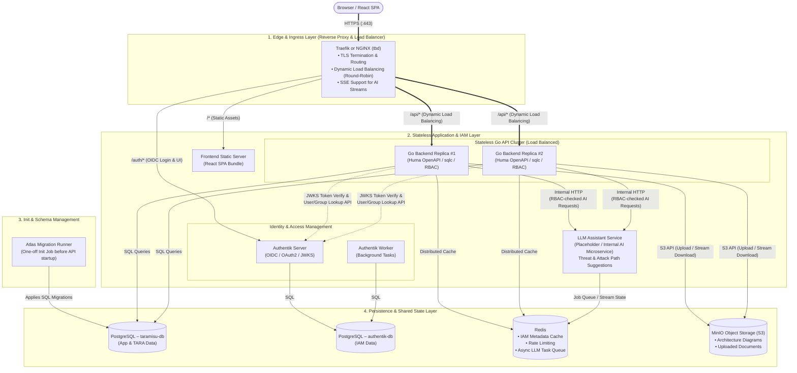
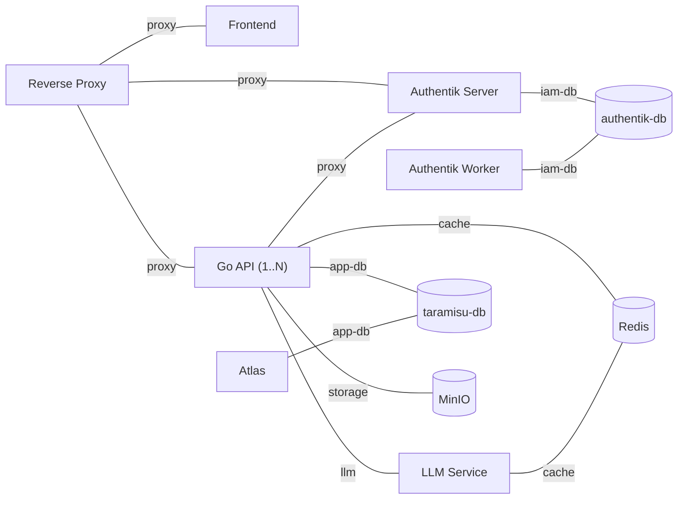

# System Architecture & Design Decisions – Taramisu

This document defines the target system architecture for the **Taramisu** web application (supporting the ISO/SAE 21434 TARA process). The architecture is designed around a **100% stateless backend tier** utilizing **Traefik or NGINX (tbd)** as a dynamic reverse proxy and load balancer.

Typical request flows (login, authenticated API calls, file upload/download, LLM requests) are visualized in [request-flows.md](./request-flows.md).

---

## 1. System Architecture Diagram

---

## 2. Network Segmentation

Every stateful component lives in its **own internal Docker network** that is shared only with the services that actually need it. Only the reverse proxy publishes ports to the host. Databases, Redis and MinIO are **never** attached to the proxy network and therefore cannot be reached from the edge.

| Network | `internal` | Members | Purpose |
| --- | --- | --- | --- |
| `proxy` | no | Reverse Proxy, Frontend, Go API, Authentik Server | Ingress routing from the edge |
| `app-db` | yes | Go API, Atlas, `taramisu-db` | Application database access |
| `iam-db` | yes | Authentik Server, Authentik Worker, `authentik-db` | IAM database access |
| `cache` | yes | Go API, LLM Service, Redis | Shared cache, rate limiting, job queue |
| `storage` | yes | Go API, MinIO | Object storage access |
| `llm` | yes | Go API, LLM Service | Internal AI requests |

> [!NOTE]
> Docker networks with `internal: true` have **no outbound internet access**. Services that need egress (e.g. Authentik Worker for e-mail delivery, or the LLM service if it calls an external model API) must additionally be attached to a non-internal network.

---

## 3. Key Architectural Decisions & Justifications

### 1. Traefik or NGINX (tbd) as Reverse Proxy & Load Balancer
* **Decision:** Evaluate **Traefik or NGINX (tbd)** as the central entrypoint and load balancer.
* **Why:** Both options are under consideration for the edge and ingress layer. While traditional NGINX is a proven and widely adopted standard, Traefik features **native Docker container auto-discovery** in its open-source version—automatically detecting scaled Go backend instances (`docker compose up --scale api=3`) via the Docker socket and balancing traffic without manual configuration reloads. The final decision will balance dynamic service discovery and load balancing capabilities in open-source setups against team familiarity and infrastructure requirements. Both support TLS termination and integration with Authentik via Forward-Auth.

### 2. 100% Stateless Go Backend (`1..N` Replicas)
* **Decision:** The Go backend holds no local sessions, files, or persistent state.
* **Why:** This allows seamless horizontal scaling behind the reverse proxy / load balancer (Traefik or NGINX (tbd)). If traffic increases or a container crashes, instances can be added or destroyed instantly without losing user data or session state.

### 3. Separate PostgreSQL Containers (`taramisu-db` vs. `authentik-db`)
* **Decision:** Run **two independent PostgreSQL containers**, one for the Taramisu application and one for Authentik, each in its own internal network (`app-db` / `iam-db`).
* **Why:** Full isolation of the IAM data from the application data: separate credentials, volumes, backups, upgrade cycles and resource limits. A compromised or misconfigured Go API has no network path to the Authentik database and vice versa. The additional operational overhead of a second PostgreSQL container is small compared to the security and lifecycle benefits.

### 4. Strict Network Segmentation
* **Decision:** Only the reverse proxy is exposed; all stateful services sit in dedicated internal networks (see [Section 2](#2-network-segmentation)).
* **Why:** Minimizes the attack surface and enforces least privilege on the network level—each service can only reach the backends it actually needs.

### 5. Zero PII in Application Database (Authentik Integration)
* **Decision:** Store only immutable external IDs (`external_iam_sub`, `external_iam_group_id`) in the Taramisu database.
* **Why:** Personal Identifiable Information (such as emails and display names) remains strictly within Authentik (Separation of Concerns / GDPR compliance). User metadata is resolved on-the-fly via Authentik’s core API and cached in Redis.

### 6. MinIO (S3-Compatible Object Storage) for File Uploads
* **Decision:** Store all binary files (architecture diagrams, PDFs, uploaded documents) in **MinIO** instead of the local container filesystem. MinIO is **only reachable by the Go API** (`storage` network); clients never talk to MinIO directly.
* **Why:** Storing files locally would break horizontal scaling behind a load balancer (since Replica #2 wouldn't have access to files uploaded to Replica #1). S3 storage ensures any backend instance can access any uploaded artifact.

### 7. File Access Authorization via the Go API
* **Decision:** Every file download goes through `GET /api/...` on the Go API. The API validates the JWT, resolves the file's owning `TARA_PROJECT`, checks the caller's `PROJECT_ROLE_ASSIGNMENT` and only then streams the object from MinIO to the client.
* **Why:** Authorization is enforced on **every** request in one place (the same RBAC logic as for all other resources) and revoked access takes effect immediately. MinIO stays fully internal. For the expected file sizes (diagrams, PDFs in the low MB range) and user count, streaming through the API is not a bottleneck.
* **Alternative (later, if needed):** The API performs the same RBAC check but answers with a redirect to a **short-lived presigned URL** (e.g. 60 s TTL). This offloads bandwidth from the API replicas but requires exposing MinIO via the proxy (e.g. under `/s3/*`) and means a URL that has already been issued stays valid until it expires.

### 8. Redis for Caching & Task Queuing (Scoped)
* **Decision:** Use **Redis** as a shared distributed in-memory store with a deliberately small scope:

  | Cached / stored | Why |
  | --- | --- |
  | Authentik user/group metadata (display name, e-mail) for rendering | Avoids one Authentik API call per displayed user; short TTL (e.g. 5–15 min) |
  | Rate-limiting counters | Must be shared across all API replicas |
  | Async LLM task queue / stream state | Long-running jobs must survive replica switches |

* **Explicitly not cached:**
  * **File contents** – Redis is not a blob store; the saving would be negligible (MinIO is already a fast local service) while memory usage would grow quickly. Repeated downloads are handled by HTTP caching instead (`ETag` + `Cache-Control: private`), so the browser revalidates but does not re-download unchanged files.
  * **Authorization decisions / project roles** – always read from `taramisu-db` so that revoked access takes effect immediately. These are cheap indexed queries.
  * **JWKS signing keys** – held in-memory per API replica (standard behavior of OIDC/JWT libraries with periodic refresh); no shared cache needed.
