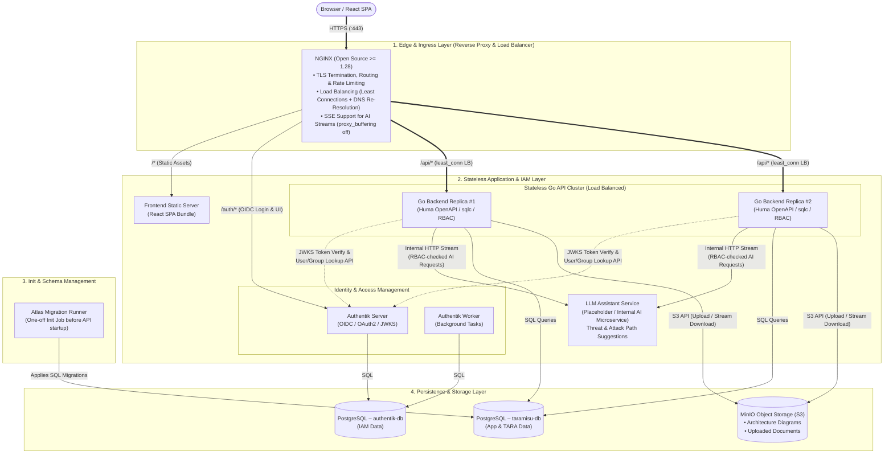
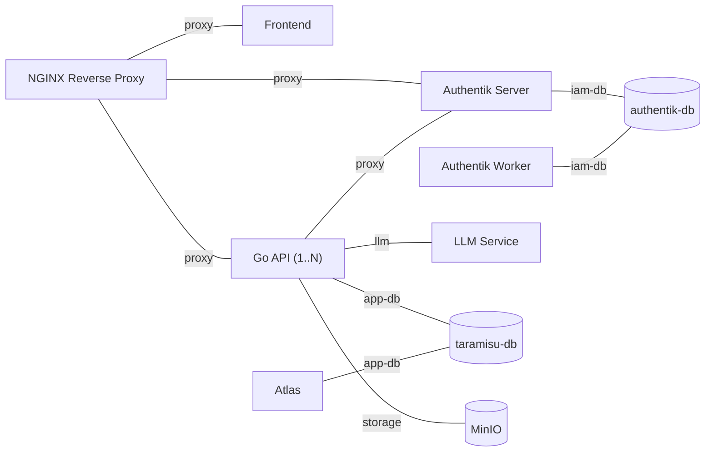

# System Architecture & Design Decisions – Taramisu

This document defines the target system architecture for the **Taramisu** web application (supporting the ISO/SAE 21434 TARA process). The architecture is designed around a **100% stateless backend tier** utilizing **NGINX** as the central reverse proxy and load balancer.

Typical request flows (login, authenticated API calls, file upload/download, LLM requests) are visualized in [request-flows.md](./request-flows.md).

---

## 1. System Architecture Diagram

---

## 2. Network Segmentation

Every stateful or internal component lives in its **own internal Docker network** that is shared only with the services that actually need it. Only NGINX publishes ports to the host. Databases, MinIO, and the LLM service are **never** attached to the proxy network and therefore cannot be reached from the edge.

| Network | `internal` | Members | Purpose |
| --- | --- | --- | --- |
| `proxy` | no | NGINX, Frontend, Go API, Authentik Server | Ingress routing from the edge |
| `app-db` | yes | Go API, Atlas, `taramisu-db` | Application database access |
| `iam-db` | yes | Authentik Server, Authentik Worker, `authentik-db` | IAM database access |
| `storage` | yes | Go API, MinIO | Object storage access |
| `llm` | yes | Go API, LLM Service | Internal AI requests (Placeholder) |

> [!NOTE]
> Docker networks with `internal: true` have **no outbound internet access**. Services that need egress (e.g. Authentik Worker for e-mail delivery, or the LLM service if it calls an external model API) must additionally be attached to a non-internal network.

---

## 3. Key Architectural Decisions & Justifications

### 1. NGINX (Open Source >= 1.28) with Least Connections Load Balancing
* **Decision:** Use **NGINX Open Source (stable >= 1.28)** as the central entrypoint, reverse proxy, and load balancer using the **Least Connections (`least_conn`)** balancing strategy and runtime DNS re-resolution (`resolve`).
* **Why:**
  * **Runtime Upstream Re-Resolution:** Since NGINX 1.28 (April 2025), the open-source version natively supports the `resolve` parameter in `upstream` blocks. Combined with Docker's internal DNS (`resolver 127.0.0.11`), NGINX dynamically picks up new container IPs when backend replicas restart, crash, or scale (`docker compose up --scale api=3`) without requiring manual reloads.
  * **Least Connections (`least_conn`):** Because the Go API handles a mix of fast JSON queries, multi-megabyte file streams, and long-lived Server-Sent Events (SSE) streams for LLM responses, `least_conn` ensures new requests are always routed to the replica with the fewest active in-flight connections.
  * **No Sticky Sessions Required:** While open-source NGINX lacks native cookie-based sticky sessions, our Go backend is 100% stateless (JWT-based auth, externalized storage in PostgreSQL and MinIO), making session affinity unnecessary.
  * **Passive Health Checks:** NGINX's built-in passive health checks (`max_fails` / `fail_timeout`) automatically failover to healthy replicas if an instance becomes unresponsive, which is fully sufficient for our use case without needing active health probing.
  * **Edge Capabilities:** Handles TLS termination, rate limiting (`limit_req_zone`), upload size limits (`client_max_body_size`), and unbuffered SSE streaming (`proxy_buffering off`).

### 2. 100% Stateless Go Backend (`1..N` Replicas)
* **Decision:** The Go backend holds no local sessions, files, or persistent state.
* **Why:** This allows seamless horizontal scaling behind NGINX. If traffic increases or a container crashes, instances can be added or destroyed instantly without losing user data or session state.

### 3. Separate PostgreSQL Containers (`taramisu-db` vs. `authentik-db`)
* **Decision:** Run **two independent PostgreSQL containers**, one for the Taramisu application and one for Authentik, each in its own internal network (`app-db` / `iam-db`).
* **Why:** Full isolation of the IAM data from the application data: separate credentials, volumes, backups, upgrade cycles and resource limits. A compromised or misconfigured Go API has no network path to the Authentik database and vice versa. The additional operational overhead of a second PostgreSQL container is small compared to the security and lifecycle benefits.

### 4. Strict Network Segmentation
* **Decision:** Only NGINX is exposed; all stateful and internal services sit in dedicated internal networks (see [Section 2](#2-network-segmentation)).
* **Why:** Minimizes the attack surface and enforces least privilege on the network level—each service can only reach the backends it actually needs.

### 5. Zero PII in Application Database (Authentik Integration)
* **Decision:** Store only immutable external IDs (`external_iam_sub`, `external_iam_group_id`) in the Taramisu database.
* **Why:** Personal Identifiable Information (such as emails and display names) remains strictly within Authentik (Separation of Concerns / GDPR compliance). User metadata is resolved on-the-fly via Authentik’s core API and cached in-memory with a short TTL.

### 6. MinIO (S3-Compatible Object Storage) for File Uploads
* **Decision:** Store all binary files (architecture diagrams, PDFs, uploaded documents) in **MinIO** instead of the local container filesystem. MinIO is **only reachable by the Go API** (`storage` network); clients never talk to MinIO directly.
* **Why:** Storing files locally would break horizontal scaling behind a load balancer (since Replica #2 wouldn't have access to files uploaded to Replica #1). S3 storage ensures any backend instance can access any uploaded artifact.

### 7. File Access Authorization via the Go API
* **Decision:** Every file download goes through `GET /api/...` on the Go API. The API validates the JWT, resolves the file's owning `TARA_PROJECT`, checks the caller's `PROJECT_ROLE_ASSIGNMENT` and only then streams the object from MinIO to the client.
* **Why:** Authorization is enforced on **every** request in one place (the same RBAC logic as for all other resources) and revoked access takes effect immediately. MinIO stays fully internal. For the expected file sizes (diagrams, PDFs in the low MB range) and user count, streaming through the API is not a bottleneck.
* **Alternative (later, if needed):** The API performs the same RBAC check but answers with a redirect to a **short-lived presigned URL** (e.g. 60 s TTL). This offloads bandwidth from the API replicas but requires exposing MinIO via NGINX (e.g. under `/s3/*`) and means a URL that has already been issued stays valid until it expires.

### 8. Lean Caching Strategy (In-Memory per Replica, No External Cache Broker)
* **Decision:** Avoid introducing an external distributed cache (such as Redis) for the current architecture phase. Instead, use lightweight **in-memory TTL caches** inside each Go API replica alongside standard HTTP caching:

  | Mechanism | Scope & Justification |
  | --- | --- |
  | **In-memory TTL cache** (per Go replica) | • **JWKS signing keys:** Standard OIDC library behavior with periodic refresh. • **Authentik user/group display metadata (`sub` $
ightarrow$ name, e-mail):** Cached for a short TTL (e.g. 5–10 min) for UI rendering. Even with multiple replicas, one initial lookup per replica every 10 minutes is negligible and avoids the operational overhead of running Redis. |
  | **Edge rate limiting** (NGINX) | Handled directly at the single NGINX ingress proxy (`limit_req_zone`) before traffic reaches the API replicas. |
  | **Browser HTTP caching** (`ETag` + `304`) | Used for file downloads (`Cache-Control: private`, `ETag = sha256`) so the browser revalidates access with the API on every request without re-transferring unchanged file blobs. |

* **Explicitly not cached:**
  * **Authorization decisions / project roles** – always read directly from `taramisu-db` so that revoked access takes effect immediately. These are fast indexed lookups.
  * **Future Extension:** If asynchronous background job queuing or cross-replica pub/sub becomes necessary in a later phase (e.g. for long-running background AI jobs), either a PostgreSQL-backed queue (`SKIP LOCKED` / River) or Redis can be introduced at that point.
