# Entity-Relationship Schema (ER Schema) 

This document defines the Entity-Relationship (ER) schema for the **Threat Analysis and Risk Assessment (TARA)** process in accordance with **ISO/SAE 21434**.

---

## 1. Mermaid ER Diagram

```mermaid
erDiagram
    %% ==========================================
    %% 1. IAM & PROJECT-BASED RBAC
    %% ==========================================
    IAM_USER ||--o{ IAM_USER_GROUP_MEMBER : "belongs to"
    IAM_GROUP ||--o{ IAM_USER_GROUP_MEMBER : "contains"
    TARA_PROJECT ||--o{ PROJECT_ROLE_ASSIGNMENT : "grants access via"
    IAM_USER ||--o{ PROJECT_ROLE_ASSIGNMENT : "assigned directly (0..N)"
    IAM_GROUP ||--o{ PROJECT_ROLE_ASSIGNMENT : "assigned as group (0..N)"

    %% ==========================================
    %% 2. PROJECT & PREREQUISITES (15.1, 15.3.1)
    %% ==========================================
    TARA_PROJECT ||--o{ ITEM_DEFINITION : "contains (0..N)"
    ITEM_DEFINITION ||--o{ ASSET : "contains (15.3.1)"
    ITEM_DEFINITION ||--o{ DAMAGE_SCENARIO : "defines context for (15.3.1)"
    ITEM_DEFINITION ||--o{ THREAT_SCENARIO : "defines context for (15.4.1)"
    ITEM_DEFINITION ||--o{ ATTACK_PATH : "defines architecture for (15.6.1.1)"

    %% ==========================================
    %% 3. ASSET & CYBERSECURITY PROPERTIES (15.3)
    %% ==========================================
    ASSET ||--o{ ASSET_CYBERSECURITY_PROPERTY : "has property (0..N at creation, >=1 when complete [RQ-15-02])"
    ASSET_CYBERSECURITY_PROPERTY ||--o{ DAMAGE_SCENARIO_ASSET_PROPERTY : "compromise leads to [RQ-15-02]"
    DAMAGE_SCENARIO ||--o{ DAMAGE_SCENARIO_ASSET_PROPERTY : "impacts relevant assets (3.1.2 Note 1, 15.3.2 NOTE 1)"

    %% ==========================================
    %% 4. IMPACT RATING (15.5)
    %% ==========================================
    DAMAGE_SCENARIO ||--o{ IMPACT_RATING : "assessed across S, F, O, P [RQ-15-04]"

    %% ==========================================
    %% 5. THREAT SCENARIO IDENTIFICATION (15.4)
    %% ==========================================
    THREAT_SCENARIO ||--o{ THREAT_SCENARIO_ASSET_PROPERTY : "compromises (0..N at creation, >=1 when complete [RQ-15-03])"
    ASSET_CYBERSECURITY_PROPERTY ||--o{ THREAT_SCENARIO_ASSET_PROPERTY : "targeted by [RQ-15-03]"
    THREAT_SCENARIO ||--o{ THREAT_DAMAGE_LINK : "leads to (15.4.2 NOTE 3)"
    DAMAGE_SCENARIO ||--o{ THREAT_DAMAGE_LINK : "corresponds to (15.4.2 NOTE 3)"

    %% ==========================================
    %% 6. ATTACK PATH & ATTACK FEASIBILITY (15.6 & 15.7)
    %% ==========================================
    THREAT_SCENARIO ||--o{ THREAT_ATTACK_PATH_LINK : "realized by [RQ-15-08], [RQ-15-09]"
    ATTACK_PATH ||--o{ THREAT_ATTACK_PATH_LINK : "realizes [RQ-15-09]"
    ATTACK_PATH ||--o| ATTACK_FEASIBILITY_RATING : "evaluated by (0..1 at creation, 1 when complete [RQ-15-10])"

    %% ==========================================
    %% 7. RISK VALUE & RISK TREATMENT (15.8 & 15.9)
    %% ==========================================
    THREAT_SCENARIO ||--o{ RISK_VALUE : "has granular risk score (1-5) [RQ-15-15]"
    IMPACT_RATING ||--o{ RISK_VALUE : "provides impact input (15.8.2 NOTE 1)"
    THREAT_SCENARIO ||--o{ RISK_TREATMENT_DECISION : "treated based on max risk [RQ-15-17]"
    RISK_VALUE ||--o{ RISK_TREATMENT_DECISION : "optionally references specific risk (15.9.1.1)"

    %% ==========================================
    %% TABLE DEFINITIONS: IAM & RBAC
    %% ==========================================

    IAM_USER {
        uuid id PK "Internal UUID"
        string external_iam_sub UK "Keycloak 'sub' or ORY Kratos 'identity.id'"
    }

    IAM_GROUP {
        uuid id PK "Internal UUID"
        string external_iam_group_id UK "Keycloak Group ID / Role or ORY Group"
    }

    IAM_USER_GROUP_MEMBER {
        uuid user_id PK, FK
        uuid group_id PK, FK
    }

    PROJECT_ROLE_ASSIGNMENT {
        uuid id PK
        uuid tara_project_id FK
        uuid user_id FK "Nullable: set if individual user is authorized"
        uuid group_id FK "Nullable: set if entire group is authorized"
        enum project_role "OWNER | EDITOR | REVIEWER | VIEWER"
        timestamp assigned_at
    }

    %% ==========================================
    %% TABLE DEFINITIONS: TARA CORE (ISO/SAE 21434)
    %% ==========================================

    TARA_PROJECT {
        uuid id PK
        string name "Top-level project name, e.g., Vehicle Platform X"
        text description "Project description"
        timestamp created_at
    }

    ITEM_DEFINITION {
        uuid id PK
        uuid tara_project_id FK
        string name "Item or Component Name"
        enum scope_type "ITEM | COMPONENT (15.1, 15.6.1.1)"
        string lifecycle_phase "e.g., Concept, Product Development (15.1)"
        text item_definition_wp_09_01 "Prerequisite [WP-09-01] (15.3.1.1, 15.4.1.1)"
        text cybersecurity_specs_wp_10_01 "Supporting Info [WP-10-01] (15.3.1.2, 15.6.1.1)"
        text architectural_design "Supporting Info (15.6.1.2, 15.7.1.2)"
        timestamp created_at
    }

    ASSET {
        uuid id PK
        uuid item_definition_id FK
        string name "e.g., Braking CAN Communication, Personal Data"
        text description "Asset description"
        enum identification_source "ITEM_DEF | IMPACT_RATING | THREAT_DERIVED | CATALOGUE (15.3.2 NOTE 2)"
    }

    ASSET_CYBERSECURITY_PROPERTY {
        uuid id PK
        uuid asset_id FK
        enum property_type "CONFIDENTIALITY | INTEGRITY | AVAILABILITY [RQ-15-02]"
        text description "Context of property on asset [WP-15-02]"
    }

    DAMAGE_SCENARIO {
        uuid id PK
        uuid item_definition_id FK
        string title "Short title of damage scenario [WP-15-01]"
        text functionality_adverse_relation "Relation between item functionality and adverse consequence (15.3.2 NOTE 1)"
        text road_user_harm_description "Description of harm to the road user (15.1, 15.3.2 NOTE 1)"
    }

    DAMAGE_SCENARIO_ASSET_PROPERTY {
        uuid id PK
        uuid damage_scenario_id FK
        uuid asset_cybersecurity_property_id FK
        text compromise_mechanism_note "How loss of property leads to damage scenario [RQ-15-02]"
    }

    IMPACT_RATING {
        uuid id PK
        uuid damage_scenario_id FK
        enum impact_category "SAFETY | FINANCIAL | OPERATIONAL | PRIVACY [RQ-15-04]"
        enum rating_value "SEVERE | MAJOR | MODERATE | NEGLIGIBLE | OMITTED [RQ-15-05]"
        boolean is_omitted_by_pm_15_07 "True if omitted due to higher criticality in another category [PM-15-07]"
        text omission_or_rating_rationale "Justification / ISO 26262-3 ref [RQ-15-06] / Annex F ref (15.5.2 NOTE 4)"
        boolean reused_from_functional_safety "True if safety impact reused from FuSi (15.5.2 NOTE 6)"
    }

    THREAT_SCENARIO {
        uuid id PK
        uuid item_definition_id FK
        string title "Title of threat scenario [WP-15-03]"
        text cause_of_compromise "Cause of compromise, e.g., Spoofing [RQ-15-03]"
        enum elicitation_method "GROUP_DISCUSSION | MALICIOUS_USE_CASE | EVITA | TVRA | PASTA | STRIDE | OTHER (15.4.2 NOTE 2)"
        text technical_notes "Interdependencies, attackers, tools, surfaces (15.4.2 NOTE 1)"
        enum aggregated_attack_feasibility "HIGH | MEDIUM | LOW | VERY_LOW (15.8.2 NOTE 2)"
        int max_risk_score "Overall maximum risk score (1-5) across all granular RISK_VALUEs [RQ-15-16]"
    }

    THREAT_SCENARIO_ASSET_PROPERTY {
        uuid id PK
        uuid threat_scenario_id FK
        uuid asset_cybersecurity_property_id FK
    }

    THREAT_DAMAGE_LINK {
        uuid id PK
        uuid threat_scenario_id FK
        uuid damage_scenario_id FK
    }

    ATTACK_PATH {
        uuid id PK
        uuid item_definition_id FK
        string title "Attack path identifier/title [WP-15-05]"
        enum analysis_approach "TOP_DOWN | BOTTOM_UP (15.6.2 NOTE 1)"
        boolean is_partial_early_stage "True if incomplete in early development (15.6.2 NOTE 2 & 3)"
        jsonb attack_steps_and_weaknesses "Ordered steps (i, ii, iii) & exploited weaknesses [WP-08-04, WP-10-05, WP-08-05]"
    }

    THREAT_ATTACK_PATH_LINK {
        uuid id PK
        uuid threat_scenario_id FK
        uuid attack_path_id FK
    }

    ATTACK_FEASIBILITY_RATING {
        uuid id PK
        uuid attack_path_id FK "1:1 relationship with ATTACK_PATH [RQ-15-10]"
        int ap_elapsed_time "Numerical score for Elapsed Time [RC-15-12a]"
        int ap_specialist_expertise "Numerical score for Specialist Expertise [RC-15-12b]"
        int ap_knowledge_of_item "Numerical score for Knowledge of item/component [RC-15-12c]"
        int ap_window_of_opportunity "Numerical score for Window of Opportunity [RC-15-12d]"
        int ap_equipment "Numerical score for Equipment [RC-15-12e]"
        int ap_total_score "Sum of the 5 core attack potential factors (ISO/IEC 18045 / Annex G.2)"
        enum feasibility_rating "HIGH | MEDIUM | LOW | VERY_LOW [RQ-15-10], [WP-15-06]"
        text rationale "Justification for the attack potential scores"
    }

    RISK_VALUE {
        uuid id PK
        uuid threat_scenario_id FK "Assessed Threat Scenario [RQ-15-15]"
        uuid impact_rating_id FK "Specific Impact Rating of associated Damage Scenario (15.8.2 NOTE 1)"
        int risk_score "Granular integer score between 1 (minimal) and 5 [RQ-15-16], [WP-15-07]"
        enum determination_method "RISK_MATRIX | RISK_FORMULA (15.8.2 EXAMPLE)"
    }

    RISK_TREATMENT_DECISION {
        uuid id PK
        uuid threat_scenario_id FK "Treated Threat Scenario [RQ-15-17]"
        uuid risk_value_id FK "Nullable: references dominant/specific RISK_VALUE if applicable (15.9.1.1)"
        enum treatment_option "AVOIDING | REDUCING | SHARING | RETAINING [RQ-15-17]"
        text decision_rationale "Justification / Security Goal / Contract or Insurance ref [WP-15-08]"
        boolean is_cybersecurity_claim "True if RETAINING or SHARING -> requires Clause 8 monitoring (15.9.2 NOTE)"
    }
```

---

## 2. Key Architectural & Normative Design Decisions

### 2.1 Project Container, Item Definitions & External IAM / RBAC Integration
* **Project Hierarchy (`TARA_PROJECT` & `ITEM_DEFINITION`):** `TARA_PROJECT` represents a top-level organizational project (e.g., a vehicle platform) and acts as the authorization boundary for Role-Based Access Control (RBAC). A `TARA_PROJECT` contains one or more `ITEM_DEFINITION` instances. According to **Clause 15.1**, TARA methods are generic modules invoked at any point in the lifecycle of an *Item* or *Component*. `ITEM_DEFINITION` represents this specific assessment scope, holding the mandatory input prerequisites (`item_definition_wp_09_01` per **15.3.1.1** / **15.4.1.1** and `cybersecurity_specs_wp_10_01` per **15.6.1.1 NOTE**).
* **Decoupled Authentication (`IAM_USER`, `IAM_GROUP`):** User authentication and profile management are handled externally (e.g., via Keycloak or ORY Kratos). Following strict separation of concerns, no redundant user-specific metadata (such as emails or display names) is stored in the application database; it stores only immutable external references (`external_iam_sub`, `external_iam_group_id`).
* **Resource-Level Authorization (`PROJECT_ROLE_ASSIGNMENT`):** Enables assigning roles (`OWNER`, `EDITOR`, `REVIEWER`, `VIEWER`) on a `TARA_PROJECT` either to an individual user (`user_id`) or to an entire group (`group_id`).

### 2.2 Separation of Assets and Cybersecurity Properties (`[RQ-15-02]`, `[WP-15-02]`)
* **Granular Property Modeling (`ASSET` & `ASSET_CYBERSECURITY_PROPERTY`):** **Clause 15.3.2 `[RQ-15-02]`** requires identifying assets along with the specific cybersecurity properties (*Confidentiality, Integrity, Availability*) whose compromise leads to a damage scenario (**15.3.2 EXAMPLE 1 & 2**). Modeling `ASSET_CYBERSECURITY_PROPERTY` as a dedicated entity ensures that both Damage Scenarios (`[RQ-15-02]`) and Threat Scenarios (`[RQ-15-03]`) reference an exact *(Asset + Property)* combination rather than an unspecific asset.
* **Many-to-Many ($N:M$) Mapping to Damage Scenarios (`DAMAGE_SCENARIO_ASSET_PROPERTY`):** Per **Clause 3.1.2, Note 1** and **15.3.2 NOTE 1**, a single Damage Scenario can involve multiple relevant assets, and the compromise of a single asset property can lead to multiple distinct Damage Scenarios.

### 2.3 Many-to-Many ($N:M$) Threat Scenario Relationships (`[RQ-15-03]`, `15.4.2`)
* **Threat Scenario $\leftrightarrow$ Asset Cybersecurity Property (`THREAT_SCENARIO_ASSET_PROPERTY`):** **Clause 15.4.2 `[RQ-15-03]`** requires each Threat Scenario to specify the targeted asset, the compromised cybersecurity property, and the cause of compromise. Furthermore, **15.4.2 NOTE 1** and **15.4.2 EXAMPLE** (*"Spoofing of CAN messages for the braking ECU leads to loss of integrity of the CAN messages and thereby to loss of integrity of the braking function"*) demonstrate that a single threat scenario can affect multiple interdependent assets or multiple properties (e.g., simultaneous loss of *Integrity* and *Availability*) through a single cause of compromise. The associative table `THREAT_SCENARIO_ASSET_PROPERTY` models this $N:M$ relationship cleanly.
* **Threat Scenario $\leftrightarrow$ Damage Scenario (`THREAT_DAMAGE_LINK`):** Explicitly required by **15.4.2 NOTE 3**: *"A damage scenario can correspond to multiple threat scenarios and a threat scenario can lead to multiple damage scenarios."*

### 2.4 Separation of Attack Path Analysis (`15.6`) and Attack Feasibility Rating (`15.7`)
* **Dedicated `ATTACK_PATH` Entity (`[WP-15-05]`):** Captures the structural path analysis required by **`[RQ-15-08]`** and **`[RQ-15-09]`**, including whether the path was derived top-down or bottom-up (**15.6.2 NOTE 1**), whether it is a partial path in early development stages (**15.6.2 NOTE 2 & 3**), and the ordered sequence of steps (`i, ii, iii` per **15.6.2 EXAMPLE**) and exploited weaknesses (`[WP-08-04]`, `[WP-10-05]`, `[WP-08-05]` per **15.6.1.2**). Because an attack path can realize multiple threat scenarios and a threat scenario can be realized by multiple attack paths (**`[RQ-15-09]`**, **15.8.2 NOTE 2**), they are linked via `THREAT_ATTACK_PATH_LINK` ($N:M$).
* **Dedicated `ATTACK_FEASIBILITY_RATING` Entity (`[WP-15-06]`):** Kept separate from `ATTACK_PATH` ($1:1$ per **`[RQ-15-10]`**) to maintain narrow, cohesive tables and mirror the modular separation between Clause 15.6 and Clause 15.7. It implements the **Attack-potential-based approach (`[RC-15-11a]` & `[RC-15-12]`)** using numerical scores for the 5 core factors derived from ISO/IEC 18045 (**15.7.2 NOTE 2 & 3**):
  1. `ap_elapsed_time` (**`[RC-15-12a]`**)
  2. `ap_specialist_expertise` (**`[RC-15-12b]`**)
  3. `ap_knowledge_of_item` (**`[RC-15-12c]`**)
  4. `ap_window_of_opportunity` (**`[RC-15-12d]`**)
  5. `ap_equipment` (**`[RC-15-12e]`**)

### 2.5 Two-Stage Risk Value Determination: Granular Calculation & Maximum Aggregation (`15.8`)
* **Stage 1 – Granular Risk Calculation per Impact Category (`RISK_VALUE`):** According to **`[RQ-15-15]`** and **15.8.2 NOTE 1**, if a threat scenario corresponds to multiple damage scenarios and/or has impacts across multiple impact categories (*Safety, Financial, Operational, Privacy* per **`[RQ-15-04]`**), a separate risk value (integer 1 to 5 per **`[RQ-15-16]`**) is determined for each associated `IMPACT_RATING` combined with the threat scenario's `aggregated_attack_feasibility` (**15.8.2 NOTE 2**).
* **Stage 2 – Overall Maximum Risk Aggregation (`THREAT_SCENARIO.max_risk_score`):** For the overall evaluation of a Threat Scenario, the highest granular risk score across all associated Damage Scenarios and SFOP categories dominates (e.g., if Safety Risk = `5` and Operational Risk = `2`, the overall `max_risk_score` of the Threat Scenario is `5`). Storing the granular records in `RISK_VALUE` while maintaining `max_risk_score` on `THREAT_SCENARIO` provides full audit traceability per category alongside an immediate worst-case risk rating for decision-making.

### 2.6 Risk Treatment Decision (`15.9`)
* **Treatment on Threat Scenario Level (`RISK_TREATMENT_DECISION`):** Per **`[RQ-15-17]`**, for each threat scenario—considering its risk values—one or more risk treatment options (`AVOIDING`, `REDUCING`, `SHARING`, `RETAINING`) are selected. Linking `RISK_TREATMENT_DECISION` directly to `THREAT_SCENARIO` (with an optional reference `risk_value_id` to the dominant or category-specific `RISK_VALUE`) allows teams to treat the Threat Scenario as a whole based on its maximum risk (`max_risk_score`), while still permitting category-specific treatments (e.g., `SHARING` financial risk via insurance per **15.9.2 EXAMPLE 2**).
* **Cybersecurity Claims (`is_cybersecurity_claim`):** Captures **15.9.2 NOTE**, requiring rationales for `RETAINING` and `SHARING` to be recorded as cybersecurity claims subject to Clause 8 monitoring.

---

## 3. Entity & Attribute Reference Matrix

| Entity (Table) | ISO/SAE 21434 Clause & Work Product | Purpose & Required Attributes Justification |
| :--- | :--- | :--- |
| **`IAM_USER`**, **`IAM_GROUP`**, **`IAM_USER_GROUP_MEMBER`**, **`PROJECT_ROLE_ASSIGNMENT`** | App Infrastructure (RBAC) | Maps external IAM technical IDs (`external_iam_sub`, `external_iam_group_id`) without redundant user metadata to `TARA_PROJECT` instances with specific roles (`OWNER`, `EDITOR`, `REVIEWER`, `VIEWER`). |
| **`TARA_PROJECT`** | App Organizational Hierarchy | Top-level project container (e.g., vehicle platform) grouping multiple `ITEM_DEFINITION` scopes and serving as the RBAC authorization boundary. |
| **`ITEM_DEFINITION`** | **15.1, 15.3.1, 15.4.1, 15.6.1, 15.9.1** (`[WP-09-01]`, `[WP-10-01]`) | Specific TARA scope under a `TARA_PROJECT`. Stores `scope_type` (`ITEM \| COMPONENT` per **15.6.1.1 NOTE**), `lifecycle_phase` (**15.1**), and prerequisite references. |
| **`ASSET`** | **15.3** (`[RQ-15-02]`, **15.3.2 NOTE 2**) | Represents system assets within an `ITEM_DEFINITION`. Tracks `identification_source` (*Item Definition, Impact Rating, Threat Derived, Catalogue*). |
| **`ASSET_CYBERSECURITY_PROPERTY`** | **15.3** (`[RQ-15-02]`, `[WP-15-02]`) | Stores the specific security properties (`CONFIDENTIALITY \| INTEGRITY \| AVAILABILITY`) assigned to an `ASSET`. |
| **`DAMAGE_SCENARIO`** | **15.3** (`[RQ-15-01]`, `[WP-15-01]`) | Documents adverse consequences (`functionality_adverse_relation`) and harm to the road user (`road_user_harm_description` per **15.3.2 NOTE 1**). |
| **`DAMAGE_SCENARIO_ASSET_PROPERTY`** | **15.3** (`[RQ-15-02]`, **3.1.2 Note 1**, **15.3.2 NOTE 1**) | $N:M$ join table linking Damage Scenarios to the compromised `ASSET_CYBERSECURITY_PROPERTY` entries. |
| **`IMPACT_RATING`** | **15.5** (`[RQ-15-04]` to `[PM-15-07]`, `[WP-15-04]`) | Evaluates a Damage Scenario for each category (`SAFETY \| FINANCIAL \| OPERATIONAL \| PRIVACY`) as `SEVERE \| MAJOR \| MODERATE \| NEGLIGIBLE` or `OMITTED` (**`[PM-15-07]`**), including ISO 26262-3 references (**`[RQ-15-06]`**). |
| **`THREAT_SCENARIO`** | **15.4 & 15.8** (`[RQ-15-03]`, `[WP-15-03]`, **15.8.2 NOTE 2**) | Stores `cause_of_compromise`, `elicitation_method` (e.g., STRIDE, EVITA per **15.4.2 NOTE 2**), `aggregated_attack_feasibility` (max across attack paths), and `max_risk_score` (max across granular risk values). |
| **`THREAT_SCENARIO_ASSET_PROPERTY`** | **15.4** (`[RQ-15-03]`, **15.4.2 NOTE 1 & EXAMPLE**) | $N:M$ join table allowing a Threat Scenario to target and compromise one or multiple `ASSET_CYBERSECURITY_PROPERTY` entries. |
| **`THREAT_DAMAGE_LINK`** | **15.4** (**15.4.2 NOTE 3**) | $N:M$ join table connecting Threat Scenarios and Damage Scenarios. |
| **`ATTACK_PATH`** & **`THREAT_ATTACK_PATH_LINK`** | **15.6** (`[RQ-15-08]`, `[RQ-15-09]`, `[WP-15-05]`) | Stores the attack path metadata (`analysis_approach`, `is_partial_early_stage`, `attack_steps_and_weaknesses`) and links paths to Threat Scenarios ($N:M$). |
| **`ATTACK_FEASIBILITY_RATING`** | **15.7** (`[RQ-15-10]`, `[RC-15-11a]`, `[RC-15-12]`, `[WP-15-06]`) | $1:1$ table to `ATTACK_PATH`. Evaluates the 5 numerical Attack Potential core factors (`ap_elapsed_time`, `ap_specialist_expertise`, `ap_knowledge_of_item`, `ap_window_of_opportunity`, `ap_equipment`), `ap_total_score`, and resulting `feasibility_rating`. |
| **`RISK_VALUE`** | **15.8** (`[RQ-15-15]`, `[RQ-15-16]`, **15.8.2 NOTE 1**, `[WP-15-07]`) | Stores the granular risk score (`1` to `5`) for each combination of `THREAT_SCENARIO` and associated `IMPACT_RATING` (S, F, O, P). |
| **`RISK_TREATMENT_DECISION`** | **15.9** (`[RQ-15-17]`, **15.9.2 NOTE**, `[WP-15-08]`) | Stores the treatment decision (`AVOIDING \| REDUCING \| SHARING \| RETAINING`), rationale, and Cybersecurity Claim flag (`is_cybersecurity_claim`) for a `THREAT_SCENARIO`. |
