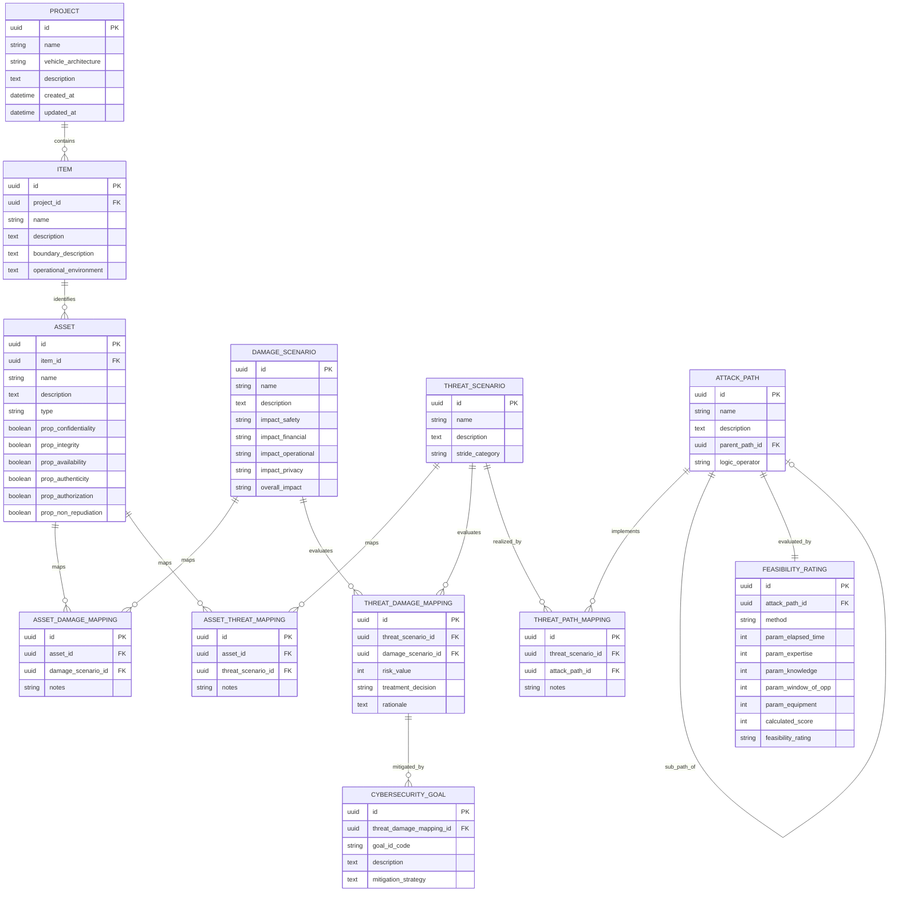
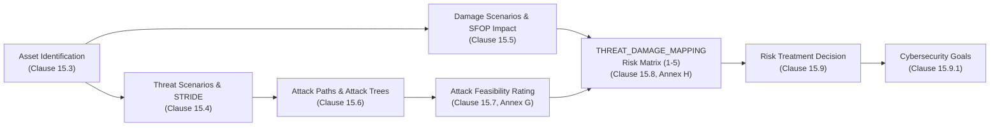

# ISO/SAE 21434 TARA Data Model Specification

This document defines the normative, comprehensive Entity-Relationship (ER) data model for the Threat Analysis and
Risk Assessment (TARA) platform. The architecture strictly operationalizes the requirements of **ISO/SAE
21434:2021** (Road Vehicles — Cybersecurity Engineering), synthesizing system definition (Clause 9), asset and
threat elicitation (Clauses 15.3–15.4), attack analysis (Clauses 15.6–15.7), risk determination (Clause 15.8), and
risk treatment (Clause 15.9).

---

## 1. Architectural Overview & Design Principles

### 1.1 The Shift to Many-to-Many (M:N) Mapping Architecture
Earlier conceptual iterations of automotive TARA tools often assumed linear, hierarchical trees
(e.g., Asset -> Threat -> Damage -> Risk). However, a strict reading of ISO/SAE 21434
Clause 15 mandates a fully decoupled **n:m (Many-to-Many)** relational model:
- **Asset <-> Damage Scenario (Clause 15.3.2, Note 1):** A single damage scenario can result from
  compromised security properties across multiple assets. Conversely, compromising one central asset can trigger
  multiple distinct damage scenarios.
- **Asset <-> Threat Scenario (Clause 15.4.1, Note 2):** A generic threat scenario (e.g., spoofing
  telemetry frames) can affect multiple assets, while an individual asset is exposed to diverse threats.
- **Threat Scenario <-> Damage Scenario (Clause 15.4.2, Note 3):** A single threat scenario can
  trigger multiple cascading damage scenarios, and a damage scenario can be realized through distinct threat
  scenarios.
- **Threat Scenario <-> Attack Path (Clause 15.6.2, RQ-15-09):** One attack path can simultaneously
  enable multiple threat scenarios, while one threat scenario may be exploitable via several attack vectors.

### 1.2 Placement of Risk Value and Risk Treatment
In ISO/SAE 21434, **Risk Value is NOT a property of a Threat Scenario alone**. Clause 15.8.2, Note 1 states:
> *"If a threat scenario corresponds to more than one damage scenario and/or an associated damage
> scenario has impacts in more than one impact category, a separate risk value can be determined
> separately for each of those impact ratings."*

Risk is mathematically and methodologically the combination of **Feasibility** (derived from the Threat Scenario
and its underlying Attack Paths) and **Impact** (derived from the Damage Scenario). Because the relationship
between Threat Scenarios and Damage Scenarios is n:m, the `risk_value` and its resulting `treatment_decision`
belong strictly in the intersection junction table (`THREAT_DAMAGE_MAPPING`).

---

## 2. Complete Entity-Relationship Diagram

---

## 3. Detailed Entity & Table Specifications

### 3.1 `PROJECT` Table
The organizational container representing the vehicle platform, program, or development project.

| Attribute | Description |
| :--- | :--- |
| `id` | PK. Unique internal database identifier. |
| `name` | Project or vehicle program name (e.g., "EV-Platform-2027"). |
| `vehicle_architecture` | Target electrical/electronic (E/E) architecture (e.g., Zonal, Domain). |
| `description` | High-level summary of the vehicle project and scope. |

*   **Attribute Justification:** Automotive cybersecurity relies heavily on architecture paradigms. Capturing this context at the project level establishes system boundaries and shared baseline assumptions. Timestamps (`created_at`, `updated_at`) are mandated by quality management and cybersecurity auditability requirements (Clause 5).
*   **Relationship Justification (1:N with `ITEM`):** A vehicle project comprises multiple items and sub-systems. Each item is scoped to a specific project.

---

### 3.2 `ITEM` Table (ISO/SAE 21434 Clause 9: Item Definition)
Represents the system, component, or function subject to analysis.

| Attribute | Description |
| :--- | :--- |
| `id` | PK. Unique identifier. |
| `project_id` | FK (`PROJECT.id`). References the parent vehicle project. |
| `name` | Item name (Clause 9.3: e.g., "Central Telematics Gateway"). |
| `description` | High-level functional description (Clause 9.3.1.2). |
| `boundary_description` | Definition of physical, logical, and electrical boundaries. |
| `operational_environment` | Operating conditions, network topologies, external interfaces. |

*   **Attribute Justification:** `boundary_description` is explicitly required by Clause 9.3.1.2 to define the item's perimeter. `operational_environment` is required to identify external entities, diagnostic tools, and RF protocols the item interacts with.
*   **Relationship Justification (N:1 with `PROJECT`, 1:N with `ASSET`):** Every item is scoped to exactly one project context and contains multiple decomposed assets.

---

### 3.3 `ASSET` Table (Clause 15.3: Asset Identification)
Assets are components, software modules, or data objects whose compromise produces adverse consequences.

| Attribute | Description |
| :--- | :--- |
| `id` | PK. Unique identifier. |
| `item_id` | FK (`ITEM.id`). Item to which the asset belongs. |
| `name` | Identifier of the asset (e.g., "Firmware Image", "CAN Secret Key"). |
| `type` | Classification: `DATA`, `HARDWARE`, `SOFTWARE`, `COMPONENT` (Clause 15.3.1). |
| `prop_*` | Booleans for CIA Triad + Authenticity, Authorization, Non-Repudiation. |

*   **Attribute Justification:** Clause 15.3.1 mandates evaluating the classic CIA triad. In automotive engineering, Authenticity, Authorization, and Non-Repudiation are routinely evaluated alongside CIA to support STRIDE threat modeling. Storing these as flags enables granular identification of damage mechanisms.
*   **Relationship Justification:** M:N with `DAMAGE_SCENARIO` and `THREAT_SCENARIO` via mapping tables.

---

### 3.4 `DAMAGE_SCENARIO` Table (Clauses 15.3 & 15.5: Impact Rating)
Describes adverse events affecting vehicle functions, passengers, or external stakeholders.

| Attribute | Description |
| :--- | :--- |
| `id` | PK. Unique identifier. |
| `name` | Concise scenario title. |
| `impact_safety` ... `impact_privacy` | Rating: `SEVERE`, `MAJOR`, `MODERATE`, `NEGLIGIBLE`. |
| `overall_impact` | Maximum/dominant rating among S, F, O, and P (Clause 15.5.2). |

*   **Attribute Justification:** Clause 15.5 and Annex F formally define these four normative impact categories (SFOP). `overall_impact` derives the consolidated rating following the worst-case principle (max(SFOP)).
*   **Relationship Justification:** M:N with `ASSET` and `THREAT_SCENARIO`.

---

### 3.5 `ASSET_DAMAGE_MAPPING` Table (Junction Table)
Implements the M:N relationship between assets and damage scenarios.

| Attribute | Description |
| :--- | :--- |
| `id` | PK. Unique identifier. |
| `asset_id` | FK (`ASSET.id`). |
| `damage_scenario_id` | FK (`DAMAGE_SCENARIO.id`). |
| `notes` | Context explaining exactly *how* the specific asset's compromise causes this specific damage. |

*   **Attribute Justification:** The `notes` field is critical for audits to justify the logical linkage, avoiding "black box" connections in the database.
*   **Relationship Justification (M:N Mandate - Clause 15.3.2, Note 1):** The damage scenario *"Loss of steering control"* can be caused by compromising the *Steering Angle Sensor Data* asset OR the *EPS Firmware* asset.

---

### 3.6 `THREAT_SCENARIO` Table (Clause 15.4: Threat Scenario Identification)
Describes potential cybersecurity attacks that violate asset properties.

| Attribute | Description |
| :--- | :--- |
| `id` | PK. Unique identifier. |
| `name` | Threat designation (e.g., "Spoofing Diagnostic UDS Messages"). |
| `stride_category` | Classification: `SPOOFING`, `TAMPERING`, `REPUDIATION`, etc. |

*   **Attribute Justification:** Clause 15.4 references established threat classification methodologies such as STRIDE to ensure exhaustive elicitation across all threat surfaces.
*   **Relationship Justification:** M:N with `ASSET`, `DAMAGE_SCENARIO`, and `ATTACK_PATH`.

---

### 3.7 `ASSET_THREAT_MAPPING` Table (Junction Table)
Connects assets to the threat scenarios that compromise them.

| Attribute | Description |
| :--- | :--- |
| `asset_id` | FK (`ASSET.id`). |
| `threat_scenario_id` | FK (`THREAT_SCENARIO.id`). |

*   **Relationship Justification (M:N Mandate - Clause 15.4.1, Note 2):** A generic threat scenario (*"Tampering with telemetry frames"*) can compromise multiple data assets on a bus. Conversely, one asset (*"Secure Boot Key"*) can be targeted by multiple threat scenarios.

---

### 3.8 `THREAT_DAMAGE_MAPPING` Table (Clauses 15.8 & 15.9: Risk Determination & Treatment)
The central convergence table where risk values are computed and risk treatment decisions are formally recorded.

| Attribute | Description |
| :--- | :--- |
| `threat_scenario_id` | FK (`THREAT_SCENARIO.id`). |
| `damage_scenario_id` | FK (`DAMAGE_SCENARIO.id`). |
| `risk_value` | Determined risk score (Level 1 to 5, Annex H). |
| `treatment_decision` | Strategy: `AVOID`, `REDUCE`, `SHARE`, `RETAIN`. |
| `rationale` | Mandatory justification for `RETAIN`, `SHARE`, or `AVOID`. |

*   **Attribute Justification:** `treatment_decision` covers the four exhaustive options of Clause 15.9.1. `rationale` is mandated by Clause 15.9.2 to document auditable justifications.
*   **Relationship Justification (Placement of Risk - Clause 15.8.2, Note 1):** Because Feasibility belongs to the Threat and Impact belongs to the Damage, the resulting Risk Level strictly exists at their intersection. Storing `risk_value` directly on `THREAT_SCENARIO` fails when one threat produces severe damage in one context but minor damage in another.

---

### 3.9 `ATTACK_PATH` Table (Clause 15.6: Attack Path Analysis)
Defines the concrete sequence of adversarial actions to execute a threat scenario, supporting Attack Trees.

| Attribute | Description |
| :--- | :--- |
| `parent_path_id` | FK (`ATTACK_PATH.id`), NULLABLE. Self-referencing link to parent node. |
| `logic_operator` | Tree logic: `ROOT`, `AND`, `OR`, `LEAF`. |

*   **Attribute & Relationship Justification:** Clause 15.6.2 (Note 1) explicitly recommends Top-down (Attack Trees) and Bottom-up (Attack Graphs). A self-referencing `parent_path_id` structure combined with `logic_operator` allows the database to map arbitrarily deep, complex AND/OR trees without schema alterations. 

---

### 3.10 `THREAT_PATH_MAPPING` Table (Junction Table)
Connects threat scenarios with the attack paths capable of realizing them.

| Attribute | Description |
| :--- | :--- |
| `threat_scenario_id` | FK (`THREAT_SCENARIO.id`). |
| `attack_path_id` | FK (`ATTACK_PATH.id`). |

*   **Relationship Justification (M:N Mandate - Clause 15.6.2, RQ-15-09):** Achieving root access on a gateway (a single Attack Path) can realize both Threat A and Threat B. Conversely, a Threat can be achieved via multiple distinct Attack Paths.

---

### 3.11 `FEASIBILITY_RATING` Table (Clause 15.7: Feasibility Evaluation)
Quantifies how easily an attack path can be executed (Annex G.3 / ISO/IEC 18045).

| Attribute | Description |
| :--- | :--- |
| `attack_path_id` | FK (`ATTACK_PATH.id`), UNIQUE. 1:1 reference. |
| `param_elapsed_time` ... `param_equipment` | Scores based on Attack Potential parameters. |
| `calculated_score` | Sum of parameters. |
| `feasibility_rating` | Category: `HIGH`, `MEDIUM`, `LOW`, `VERY_LOW`. |

*   **Attribute Justification:** Derived directly from ISO/SAE 21434 Annex G.3. Summed points translate directly to qualitative ratings (e.g., 0-13 points -> High Feasibility).
*   **Relationship Justification (1:1 with `ATTACK_PATH` - Clause 15.7.2, RQ-15-10):** *"For each attack path, the attack feasibility rating shall be determined..."*

---

### 3.12 `CYBERSECURITY_GOAL` Table (Clause 15.9.1: Cybersecurity Goals)
Specifies high-level cybersecurity requirements defined to reduce unacceptably high risks.

| Attribute | Description |
| :--- | :--- |
| `threat_damage_mapping_id`| FK (`THREAT_DAMAGE_MAPPING.id`). The mitigated risk pair. |
| `goal_id_code` | Standardized requirement identifier (e.g., "CG_GW_001"). |
| `mitigation_strategy` | Recommended engineering concept (e.g., SecOC, HSM isolation). |

*   **Attribute Justification:** `goal_id_code` enables full traceability into downstream systems engineering tools (Jira, Polarion) as required by Clause 5.4 and Automotive SPICE (ASPICE) SEC.1. Clause 15.9.1 states that for risks where `treatment_decision = REDUCE`, cybersecurity goals shall be defined.
*   **Relationship Justification (N:1 with `THREAT_DAMAGE_MAPPING`):** Multiple cybersecurity goals may be formulated to mitigate a complex risk combination.

---

## 4. Methodological Alignment: The TARA Calculation Pipeline

