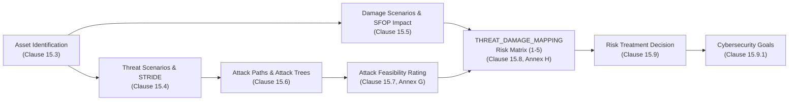

# ISO/SAE 21434 TARA Data Model Specification

This document defines the normative, comprehensive Entity-Relationship (ER) data model for the Threat Analysis and
Risk Assessment (TARA) platform. The architecture strictly operationalizes the requirements of **ISO/SAE
21434:2021** (Road Vehicles — Cybersecurity Engineering), synthesizing system definition (Clause 9), asset and
threat elicitation (Clauses 15.3–15.4), attack analysis (Clauses 15.6–15.7), risk determination (Clause 15.8), and
risk treatment (Clause 15.9).

---

## 1. Architectural Overview & Design Principles

### 1.1 The Shift to Many-to-Many (M:N) Mapping Architecture
Earlier conceptual iterations of automotive TARA tools often assumed linear, hierarchical trees
(e.g., Asset $\rightarrow$ Threat $\rightarrow$ Damage $\rightarrow$ Risk). However, a strict reading of ISO/SAE 21434
Clause 15 mandates a fully decoupled **n:m (Many-to-Many)** relational model:
- **Asset $\leftrightarrow$ Damage Scenario (Clause 15.3.2, Note 1):** A single damage scenario can result from
  compromised security properties across multiple assets. Conversely, compromising one central asset can trigger
  multiple distinct damage scenarios.
- **Asset $\leftrightarrow$ Threat Scenario (Clause 15.4.1, Note 2):** A generic threat scenario (e.g., spoofing
  telemetry frames) can affect multiple assets, while an individual asset is exposed to diverse threats.
- **Threat Scenario $\leftrightarrow$ Damage Scenario (Clause 15.4.2, Note 3):** A single threat scenario can
  trigger multiple cascading damage scenarios, and a damage scenario can be realized through distinct threat
  scenarios.
- **Threat Scenario $\leftrightarrow$ Attack Path (Clause 15.6.2, RQ-15-09):** One attack path can simultaneously
  enable multiple threat scenarios, while one threat scenario may be exploitable via several attack vectors.

### 1.2 Placement of Risk Value and Risk Treatment
In ISO/SAE 21434, **Risk Value is NOT a property of a Threat Scenario alone**. Clause 15.8.2, Note 1 states:
> *"If a threat scenario corresponds to more than one damage scenario and/or an associated damage
> scenario has impacts in more than one impact category, a separate risk value can be determined
> separately for each of those impact ratings."*

Risk is mathematically and methodologically the combination of **Feasibility** (derived from the Threat Scenario
and its underlying Attack Paths) and **Impact** (derived from the Damage Scenario). Because the relationship
between Threat Scenarios and Damage Scenarios is $n:m$, the `risk_value` and its resulting `treatment_decision`
belong strictly in the intersection junction table (`THREAT_DAMAGE_MAPPING`).

---

## 2. Complete Entity-Relationship Diagram

```mermaid
erDiagram
    PROJECT ||--o{ ITEM : "contains"
    ITEM ||--o{ ASSET : "identifies"

ASSET ||--o{ ASSET_DAMAGE_MAPPING : "maps" DAMAGE_SCENARIO ||--o{ ASSET_DAMAGE_MAPPING : "maps"

ASSET ||--o{ ASSET_THREAT_MAPPING : "maps" THREAT_SCENARIO ||--o{ ASSET_THREAT_MAPPING : "maps"

THREAT_SCENARIO ||--o{ THREAT_DAMAGE_MAPPING : "evaluates" DAMAGE_SCENARIO ||--o{ THREAT_DAMAGE_MAPPING :
"evaluates"

THREAT_SCENARIO ||--o{ THREAT_PATH_MAPPING : "realized_by" ATTACK_PATH ||--o{ THREAT_PATH_MAPPING : "implements"

ATTACK_PATH ||--o| ATTACK_PATH : "sub_path_of" ATTACK_PATH ||--|| FEASIBILITY_RATING : "evaluated_by"

THREAT_DAMAGE_MAPPING ||--o{ CYBERSECURITY_GOAL : "mitigated_by"

PROJECT { uuid id PK string name string vehicle_architecture text description datetime created_at datetime
updated_at }

ITEM { uuid id PK uuid project_id FK string name text description text boundary_description text
operational_environment }

ASSET { uuid id PK uuid item_id FK string name text description string type boolean prop_confidentiality boolean
prop_integrity boolean prop_availability boolean prop_authenticity boolean prop_authorization boolean
prop_non_repudiation }

DAMAGE_SCENARIO { uuid id PK string name text description string impact_safety string impact_financial string
impact_operational string impact_privacy string overall_impact }

ASSET_DAMAGE_MAPPING { uuid id PK uuid asset_id FK uuid damage_scenario_id FK string notes }

THREAT_SCENARIO { uuid id PK string name text description string stride_category }

ASSET_THREAT_MAPPING { uuid id PK uuid asset_id FK uuid threat_scenario_id FK string notes }

THREAT_DAMAGE_MAPPING { uuid id PK uuid threat_scenario_id FK uuid damage_scenario_id FK int risk_value string
treatment_decision text rationale }

ATTACK_PATH { uuid id PK string name text description uuid parent_path_id FK string logic_operator }

THREAT_PATH_MAPPING { uuid id PK uuid threat_scenario_id FK uuid attack_path_id FK string notes }

FEASIBILITY_RATING { uuid id PK uuid attack_path_id FK string method int param_elapsed_time int param_expertise int
param_knowledge int param_window_of_opp int param_equipment int calculated_score string feasibility_rating }

    CYBERSECURITY_GOAL {
        uuid id PK
        uuid threat_damage_mapping_id FK
        string goal_id_code
        text description
        text mitigation_strategy
    }
```

---

## 3. Detailed Entity & Table Specifications

### 3.1 `PROJECT` Table
The organizational container representing the vehicle platform, program, or development project.

| Attribute | Data Type | Constraints | Description |
| :--- | :--- | :--- | :--- |
| `id` | UUID | PK, NOT NULL | Unique internal database identifier. |
| `name` | VARCHAR(255) | NOT NULL | Project or vehicle program name (e.g., "EV-Platform-2027"). |
| `vehicle_architecture` | VARCHAR(255) | NOT NULL | Target electrical/electronic (E/E) architecture (e.g., Zonal, Domain). |
| `description` | TEXT | NULLABLE | High-level summary of the vehicle project and scope. |
| `created_at` | TIMESTAMP WITH TIME ZONE | NOT NULL | Record creation timestamp for audit trails. |
| `updated_at` | TIMESTAMP WITH TIME ZONE | NOT NULL | Record last update timestamp. |

#### Attribute Justification
- `vehicle_architecture`: Automotive cybersecurity relies heavily on architecture paradigms (central compute,
  domain gateways, zonal controllers). Capturing this context at the project level establishes system boundaries
  and shared baseline assumptions.
- `created_at` / `updated_at`: Mandated by quality management and cybersecurity auditability requirements (Clause
  5: Management of Cybersecurity).

#### Relationship Justification
- **1:N with `ITEM`:** A vehicle project comprises multiple items and sub-systems (e.g., Braking System,
  Infotainment, Telematics Gateway). Each item is scoped to a specific project.

---

### 3.2 `ITEM` Table (ISO/SAE 21434 Clause 9: Item Definition)
Represents the system, component, or function subject to analysis.

| Attribute | Data Type | Constraints | Description |
| :--- | :--- | :--- | :--- |
| `id` | UUID | PK, NOT NULL | Unique identifier. |
| `project_id` | UUID | FK (`PROJECT.id`), NOT NULL | References the parent vehicle project. |
| `name` | VARCHAR(255) | NOT NULL | Item name (Clause 9.3: e.g., "Central Telematics Gateway"). |
| `description` | TEXT | NOT NULL | High-level functional description (Clause 9.3.1.2). |
| `boundary_description` | TEXT | NOT NULL | Definition of physical, logical, and electrical boundaries. |
| `operational_environment` | TEXT | NOT NULL | Operating conditions, network topologies, external interfaces. |

#### Attribute Justification
- `name` & `description`: Mandated by Clause 9.3 to clearly identify the item under assessment.
- `boundary_description`: Clause 9.3.1.2 explicitly requires defining the item's perimeter, internal components,
  interfaces, and boundary interactions with other vehicle functions.
- `operational_environment`: Clause 9.3.1.2 requires identifying external entities, diagnostic tools, cloud
  backends, and RF protocols the item interacts with.

#### Relationship Justification
- **N:1 with `PROJECT`:** Every item is scoped to exactly one project context.
- **1:N with `ASSET`:** An item contains multiple hardware, software, or data assets identified during
  decomposition.

---

### 3.3 `ASSET` Table (Clause 15.3: Asset Identification)
Assets are components, software modules, or data objects whose compromise produces adverse consequences.

| Attribute | Data Type | Constraints | Description |
| :--- | :--- | :--- | :--- |
| `id` | UUID | PK, NOT NULL | Unique identifier. |
| `item_id` | UUID | FK (`ITEM.id`), NOT NULL | Item to which the asset belongs. |
| `name` | VARCHAR(255) | NOT NULL | Identifier of the asset (e.g., "Firmware Image", "CAN Secret Key"). |
| `description` | TEXT | NULLABLE | Detailed description of purpose and storage mechanism. |
| `type` | VARCHAR(50) | NOT NULL | Classification: `DATA`, `HARDWARE`, `SOFTWARE`, `COMPONENT`. |
| `prop_confidentiality` | BOOLEAN | NOT NULL, DEFAULT FALSE | Whether loss of confidentiality is a concern. |
| `prop_integrity` | BOOLEAN | NOT NULL, DEFAULT FALSE | Whether loss of integrity is a concern. |
| `prop_availability` | BOOLEAN | NOT NULL, DEFAULT FALSE | Whether loss of availability is a concern. |
| `prop_authenticity` | BOOLEAN | NOT NULL, DEFAULT FALSE | Whether authenticity of the asset must be safeguarded. |
| `prop_authorization` | BOOLEAN | NOT NULL, DEFAULT FALSE | Whether access authorization controls are required. |
| `prop_non_repudiation` | BOOLEAN | NOT NULL, DEFAULT FALSE | Whether non-repudiation of transactions is required. |

#### Attribute Justification
- `type`: Clause 15.3.1 categorizes assets as hardware, software, or data to determine relevant threat vectors.
- `prop_*` (Cybersecurity Properties): Clause 15.3.1 mandates evaluating the classic CIA triad (Confidentiality,
  Integrity, Availability). In automotive engineering, Authenticity, Authorization, and Non-Repudiation are
  routinely evaluated alongside CIA to support STRIDE threat modeling. Storing these as flags enables granular
  identification of damage mechanisms.

#### Relationship Justification
- **N:1 with `ITEM`:** Assets are identified within the boundary of an item.
- **M:N with `DAMAGE_SCENARIO` (via `ASSET_DAMAGE_MAPPING`):** Compromising one asset can lead to multiple damages;
  conversely, a single damage can be triggered by compromises of different assets.
- **M:N with `THREAT_SCENARIO` (via `ASSET_THREAT_MAPPING`):** Threats target asset properties; multiple assets can
  be subjected to the same threat profile.

---

### 3.4 `DAMAGE_SCENARIO` Table (Clauses 15.3 & 15.5: Impact Rating)
Describes adverse events affecting vehicle functions, passengers, or external stakeholders.

| Attribute | Data Type | Constraints | Description |
| :--- | :--- | :--- | :--- |
| `id` | UUID | PK, NOT NULL | Unique identifier. |
| `name` | VARCHAR(255) | NOT NULL | Concise scenario title (e.g., "Unintended Acceleration at Speed"). |
| `description` | TEXT | NOT NULL | Comprehensive narrative of consequences (Clause 15.3.1). |
| `impact_safety` | VARCHAR(20) | NOT NULL | Rating: `SEVERE`, `MAJOR`, `MODERATE`, `NEGLIGIBLE`. |
| `impact_financial` | VARCHAR(20) | NOT NULL | Rating: `SEVERE`, `MAJOR`, `MODERATE`, `NEGLIGIBLE`. |
| `impact_operational` | VARCHAR(20) | NOT NULL | Rating: `SEVERE`, `MAJOR`, `MODERATE`, `NEGLIGIBLE`. |
| `impact_privacy` | VARCHAR(20) | NOT NULL | Rating: `SEVERE`, `MAJOR`, `MODERATE`, `NEGLIGIBLE`. |
| `overall_impact` | VARCHAR(20) | NOT NULL | Maximum/dominant rating among S, F, O, and P (Clause 15.5.2). |

#### Attribute Justification
- `impact_safety`, `impact_financial`, `impact_operational`, `impact_privacy`: Clause 15.5 and Annex F formally
  define these four normative impact categories (SFOP). Safety impact evaluates bodily harm (often aligned with ISO
  26262 ASIL severity classes); financial covers liability, recall costs, and equipment damage; operational
  assesses functional loss; privacy covers PII and credential disclosures.
- `overall_impact`: Clause 15.5.2 specifies deriving a consolidated impact rating, typically following the worst-
  case principle ($\max(\text{SFOP})$).

#### Relationship Justification
- **M:N with `ASSET` (via `ASSET_DAMAGE_MAPPING`):** Enables multi-asset failure propagation.
- **M:N with `THREAT_SCENARIO` (via `THREAT_DAMAGE_MAPPING`):** Evaluated against threats to compute specific risk
  values.

---

### 3.5 `ASSET_DAMAGE_MAPPING` Table (Junction Table)
Implements the M:N relationship between assets and damage scenarios.

| Attribute | Data Type | Constraints | Description |
| :--- | :--- | :--- | :--- |
| `id` | UUID | PK, NOT NULL | Unique identifier. |
| `asset_id` | UUID | FK (`ASSET.id`), NOT NULL | Reference to the affected asset. |
| `damage_scenario_id` | UUID | FK (`DAMAGE_SCENARIO.id`), NOT NULL | Reference to the resulting damage scenario. |
| `notes` | TEXT | NULLABLE | Context explaining how the asset's compromise causes the damage. |

#### Relationship Justification
- **M:N Mandate (Clause 15.3.2, Note 1):** *"A damage scenario can be associated with one or multiple assets and an
  asset can be associated with one or multiple damage scenarios."*
  - Example 1: The damage scenario *"Loss of steering control"* can be caused by compromising the *Steering Angle
    Sensor Data* asset OR the *EPS Firmware* asset.
  - Example 2: Compromising the *Central Gateway Private Key* asset can cause damage scenario A (*Unauthorized
    remote unlock*) AND damage scenario B (*Malicious OTA firmware deployment*).

---

### 3.6 `THREAT_SCENARIO` Table (Clause 15.4: Threat Scenario Identification)
Describes potential cybersecurity attacks that violate asset properties.

| Attribute | Data Type | Constraints | Description |
| :--- | :--- | :--- | :--- |
| `id` | UUID | PK, NOT NULL | Unique identifier. |
| `name` | VARCHAR(255) | NOT NULL | Threat designation (e.g., "Spoofing Diagnostic UDS Messages"). |
| `description` | TEXT | NOT NULL | Detailed description of the threat action (Clause 15.4.1). |
| `stride_category` | VARCHAR(50) | NOT NULL | Classification: `SPOOFING`, `TAMPERING`, `REPUDIATION`, `INFO_DISCLOSURE`, `DENIAL_OF_SERVICE`, `ELEVATION_OF_PRIVILEGE`. |

#### Attribute Justification
- `stride_category`: Clause 15.4 (Notes) references established threat classification methodologies such as STRIDE
  to ensure exhaustive, systematic elicitation across all threat surfaces.

#### Relationship Justification
- **M:N with `ASSET` (via `ASSET_THREAT_MAPPING`):** Threat classes often cross-cut multiple assets.
- **M:N with `DAMAGE_SCENARIO` (via `THREAT_DAMAGE_MAPPING`):** Core intersection where risk determination occurs.
- **M:N with `ATTACK_PATH` (via `THREAT_PATH_MAPPING`):** Threats are operationalized by one or more attack paths.

---

### 3.7 `ASSET_THREAT_MAPPING` Table (Junction Table)
Connects assets to the threat scenarios that compromise them.

| Attribute | Data Type | Constraints | Description |
| :--- | :--- | :--- | :--- |
| `id` | UUID | PK, NOT NULL | Unique identifier. |
| `asset_id` | UUID | FK (`ASSET.id`), NOT NULL | Targeted asset. |
| `threat_scenario_id` | UUID | FK (`THREAT_SCENARIO.id`), NOT NULL | Applied threat scenario. |
| `notes` | TEXT | NULLABLE | Specific context of how the asset is violated. |

#### Relationship Justification
- **M:N Mandate (Clause 15.4.1, Note 2):** A single threat scenario (e.g., *"Tampering with telemetry frames"*) can
  compromise multiple data assets on a CAN/Ethernet bus. Conversely, an asset (e.g., *"Secure Boot Key"*) can be
  targeted by multiple threat scenarios (*"Information Disclosure via side-channel"* or *"Tampering via
  glitching"*).

---

### 3.8 `THREAT_DAMAGE_MAPPING` Table (Clauses 15.4.2, 15.8 & 15.9: Risk Determination & Treatment)
The central convergence table where risk values are computed and risk treatment decisions are formally recorded.

| Attribute | Data Type | Constraints | Description |
| :--- | :--- | :--- | :--- |
| `id` | UUID | PK, NOT NULL | Unique identifier. |
| `threat_scenario_id` | UUID | FK (`THREAT_SCENARIO.id`), NOT NULL | Associated threat scenario. |
| `damage_scenario_id` | UUID | FK (`DAMAGE_SCENARIO.id`), NOT NULL | Associated damage scenario. |
| `risk_value` | INTEGER | NOT NULL | Determined risk score (Level 1 to 5, Annex H). |
| `treatment_decision` | VARCHAR(20) | NOT NULL | Strategy: `AVOID`, `REDUCE`, `SHARE`, `RETAIN`. |
| `rationale` | TEXT | NULLABLE | Mandatory justification for `RETAIN`, `SHARE`, or `AVOID`. |

#### Attribute Justification
- `risk_value`: Clause 15.8.2 and Annex H prescribe a risk matrix mapping Feasibility (from the Threat) against
  Impact (from the Damage), yielding a scale from 1 (lowest) to 5 (highest).
- `treatment_decision`: Clause 15.9.1 defines the four exhaustive treatment options:
  - `REDUCE`: Mitigate by adding security controls and defining Cybersecurity Goals.
  - `RETAIN`: Accept residual risk (requires formal justification).
  - `SHARE`: Transfer risk (e.g., insurance, third-party contract, customer disclaimer).
  - `AVOID`: Remove the risk by altering system design (e.g., eliminating the interface).
- `rationale`: Clause 15.9.2 mandates documenting auditable justifications whenever risks are retained, shared, or
  avoided.

#### Relationship Justification
- **M:N Mandate (Clause 15.4.2, Note 3):** *"A damage scenario can correspond to multiple threat scenarios and a
  threat scenario can lead to multiple damage scenarios."*
- **Placement of Risk & Treatment (Clause 15.8.2, Note 1 & Clause 15.9.1.1 [RQ-15-17]):**
  Because Feasibility belongs to the Threat and Impact belongs to the Damage, the resulting Risk Level strictly
  exists at their intersection. Storing `risk_value` directly on `THREAT_SCENARIO` would fail when one threat
  produces severe damage in one system function (Impact = Severe $\rightarrow$ Risk = 5) but minor damage in another
  (Impact = Negligible $\rightarrow$ Risk = 1).

---

### 3.9 `ATTACK_PATH` Table (Clause 15.6: Attack Path Analysis)
Defines the concrete sequence of adversarial actions to execute a threat scenario, supporting Attack Trees.

| Attribute | Data Type | Constraints | Description |
| :--- | :--- | :--- | :--- |
| `id` | UUID | PK, NOT NULL | Unique identifier. |
| `name` | VARCHAR(255) | NOT NULL | Short title of the path step (e.g., "Exploit Buffer Overflow in Wi-Fi Stack"). |
| `description` | TEXT | NOT NULL | Technical exploitation steps and prerequisites (Clause 15.6.1). |
| `parent_path_id` | UUID | FK (`ATTACK_PATH.id`), NULLABLE | Self-referencing link to parent node for hierarchical Attack Trees. |
| `logic_operator` | VARCHAR(10) | NOT NULL, DEFAULT 'LEAF' | Tree logic: `ROOT`, `AND`, `OR`, `LEAF`. |

#### Attribute Justification
- `parent_path_id` & `logic_operator`: Clause 15.6.1 (Notes) recommends Attack Tree modeling. An attack tree
  decomposes a high-level goal into sub-steps. An `AND` node requires all child paths to succeed; an `OR` node
  requires any single child path to succeed. A self-referencing structure allows arbitrarily deep trees without
  schema alterations.

#### Relationship Justification
- **Self-referential (1:N):** Child attack steps link to their parent node via `parent_path_id`.
- **M:N with `THREAT_SCENARIO` (via `THREAT_PATH_MAPPING`):** Realizes threat scenarios.
- **1:1 with `FEASIBILITY_RATING`:** Every attack path has exactly one quantified feasibility assessment.

---

### 3.10 `THREAT_PATH_MAPPING` Table (Junction Table)
Connects threat scenarios with the attack paths capable of realizing them.

| Attribute | Data Type | Constraints | Description |
| :--- | :--- | :--- | :--- |
| `id` | UUID | PK, NOT NULL | Unique identifier. |
| `threat_scenario_id` | UUID | FK (`THREAT_SCENARIO.id`), NOT NULL | The realized threat scenario. |
| `attack_path_id` | UUID | FK (`ATTACK_PATH.id`), NOT NULL | The underlying attack path. |
| `notes` | TEXT | NULLABLE | Contextual details on realization. |

#### Relationship Justification
- **M:N Mandate (Clause 15.6.2, RQ-15-09):** *"An attack path shall be associated with the threat scenarios that
  can be realized by the attack path."*
  - Example: Achieving root access on a gateway (a single Attack Path) can realize both Threat A (*"Spoofing CAN
    messages"*) and Threat B (*"Extracting cryptographic keys"*). Conversely, Threat A can be achieved via Attack
    Path 1 (*Gateway compromise*) OR Attack Path 2 (*Physical OBD-II access*).

---

### 3.11 `FEASIBILITY_RATING` Table (Clause 15.7: Feasibility Evaluation)
Quantifies how easily an attack path can be executed, implementing the Attack Potential method (Annex G.3 / ISO/IEC 18045).

| Attribute | Data Type | Constraints | Description |
| :--- | :--- | :--- | :--- |
| `id` | UUID | PK, NOT NULL | Unique identifier. |
| `attack_path_id` | UUID | FK (`ATTACK_PATH.id`), UNIQUE, NOT NULL | 1:1 reference to the evaluated attack path. |
| `method` | VARCHAR(50) | NOT NULL, DEFAULT 'ATTACK_POTENTIAL' | Calculation standard (`ATTACK_POTENTIAL`, `CVSS`, `ATTACK_VECTOR`). |
| `param_elapsed_time` | INTEGER | NOT NULL | Score based on time needed to identify and exploit vulnerability. |
| `param_expertise` | INTEGER | NOT NULL | Score based on required attacker skills (Layman to Multiple Experts). |
| `param_knowledge` | INTEGER | NOT NULL | Score based on required system documentation (Public to Confidential). |
| `param_window_of_opp` | INTEGER | NOT NULL | Score based on access requirements (Unlimited to Difficult). |
| `param_equipment` | INTEGER | NOT NULL | Score based on tooling required (Standard to Bespoke). |
| `calculated_score` | INTEGER | NOT NULL | Arithmetic sum of the five Attack Potential parameters. |
| `feasibility_rating` | VARCHAR(20) | NOT NULL | Resulting category: `HIGH`, `MEDIUM`, `LOW`, `VERY_LOW`. |

#### Attribute Justification
- `param_*` (Attack Potential Metrics): Derived directly from ISO/SAE 21434 Annex G.3:
  - Elapsed Time: $\le 1\text{ day}$ (0 pts) to $> 6\text{ months}$ (19 pts).
  - Specialist Expertise: Layman (0 pts) to Multiple Experts (8 pts).
  - Knowledge of the Item: Public (0 pts) to Strictly Confidential (11 pts).
  - Window of Opportunity: Unlimited (0 pts) to Difficult (10 pts).
  - Equipment: Standard (0 pts) to Bespoke (7 pts).
- `calculated_score` & `feasibility_rating`: Summed points translate directly to qualitative ratings:
  - 0–13 points $\rightarrow$ **High Feasibility**
  - 14–19 points $\rightarrow$ **Medium Feasibility**
  - 20–24 points $\rightarrow$ **Low Feasibility**
  - $\ge 25$ points $\rightarrow$ **Very Low Feasibility**

#### Relationship Justification
- **1:1 with `ATTACK_PATH` (Clause 15.7.2, RQ-15-10):** *"For each attack path, the attack feasibility rating shall
  be determined..."* Feasibility is intrinsic to a specific sequence of exploit steps.

---

### 3.12 `CYBERSECURITY_GOAL` Table (Clause 15.9.1: Cybersecurity Goals)
Specifies high-level cybersecurity requirements defined to reduce unacceptably high risks.

| Attribute | Data Type | Constraints | Description |
| :--- | :--- | :--- | :--- |
| `id` | UUID | PK, NOT NULL | Unique identifier. |
| `threat_damage_mapping_id` | UUID | FK (`THREAT_DAMAGE_MAPPING.id`), NOT NULL | The mitigated threat-damage risk pair. |
| `goal_id_code` | VARCHAR(50) | NOT NULL | Standardized requirement identifier (e.g., "CG_GW_001"). |
| `description` | TEXT | NOT NULL | Top-level cybersecurity requirement statement (Clause 15.9.1). |
| `mitigation_strategy` | TEXT | NULLABLE | Recommended engineering concept (e.g., SecOC, HSM isolation). |

#### Attribute Justification
- `goal_id_code`: Enables full traceability into downstream systems engineering and requirement tracking tools
  (e.g., Jira, Polarion, Doors) as required by Clause 5.4.
- `description` & `mitigation_strategy`: Clause 15.9.1 states that for risks where `treatment_decision = REDUCE`,
  cybersecurity goals shall be defined to specify properties and operational constraints that neutralize the threat
  or prevent the damage scenario.

#### Relationship Justification
- **N:1 with `THREAT_DAMAGE_MAPPING`:** Multiple cybersecurity goals may be formulated to mitigate a complex risk
  combination (e.g., one goal preventing message spoofing and another goal enforcing rate limiting).

---

## 4. Methodological Alignment: The TARA Calculation Pipeline



### Risk Determination Matrix (Annex H)
The relational engine computes `risk_value` dynamically using the intersection of `overall_impact`
(from `DAMAGE_SCENARIO`) and `feasibility_rating` (from the most feasible underlying `ATTACK_PATH`):

| Feasibility \ Impact | Negligible | Moderate | Major | Severe |
| :--- | :---: | :---: | :---: | :---: |
| **High** | 1 | 3 | 4 | **5** |
| **Medium** | 1 | 2 | 3 | **4** |
| **Low** | 1 | 1 | 2 | **3** |
| **Very Low** | 1 | 1 | 1 | **2** |

This confirms why storing `risk_value` in `THREAT_DAMAGE_MAPPING` is the only architecture compliant with both the
relational normal forms and ISO/SAE 21434.
