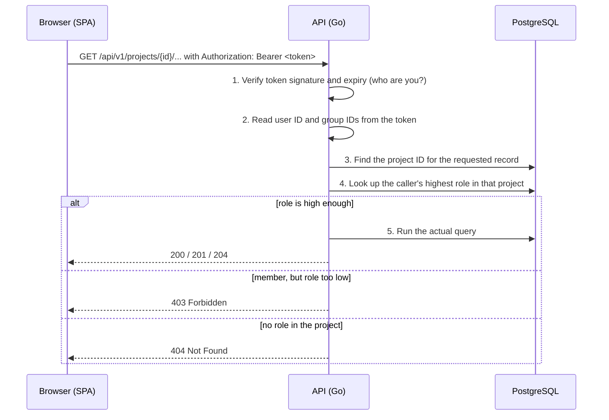

# Project roles and permissions

Status: proposal for [#143](https://github.com/thi-taramisu/taramisu/issues/143), under team review.
Implementation follows in [#186](https://github.com/thi-taramisu/taramisu/issues/186). Earlier role lists in other documents were
unagreed examples; this document replaces them once approved.

## TL;DR

- A project has three roles: **Viewer** reads, **Editor** also changes the analysis, **Owner** also manages the project.
- Every user approved in Authentik can create projects and becomes the first Owner of each project they create.
- Roles can be given to a single user or to an Authentik group. If several apply, the highest one counts.
- Every project keeps at least one Owner who is a user, not a group.
- The backend checks every request. Users without any role get `404 Not Found`; users whose role is too low get `403 Forbidden`.

## Who can do what

The rows follow the features planned in the [wireframe concept](../../concepts/wireframes/concept-descriptions.md),
[frontend routes](../../frontend-routes.md), and the [project brief](../../../external/overview.md#intended-scope).

| Action | Viewer | Editor | Owner |
| --- | :-: | :-: | :-: |
| See the project in the project list; open the workspace, results, graph, and risk views | ✓ | ✓ | ✓ |
| Use the guidance sidebar | ✓ | ✓ | ✓ |
| Export the project | ✓ | ✓ | ✓ |
| Mark the project as a favourite (personal, does not change the project) | ✓ | ✓ | ✓ |
| See the member list | ✓ | ✓ | ✓ |
| Leave the project (not as the last Owner) | ✓ | ✓ | ✓ |
| Create, edit, and delete analysis content: items, assets, cybersecurity properties, damage and threat scenarios, attack paths, ratings, risk values, treatment decisions, relations, files | – | ✓ | ✓ |
| Apply AI assistant suggestions | – | ✓ | ✓ |
| Change project settings: name, description, image, default rating method, AI toggle | – | – | ✓ |
| Add or remove members and groups; change their roles | – | – | ✓ |
| Archive, restore, or delete the project | – | – | ✓ |

Actions that need no project role:

- **Create a project**: every active user. The creator becomes Owner. Import creates a new project in the first version, so the
  same rule applies to importing.
- **Approve accounts**: done by Authentik administrators ([registration flow](registration-flow.md)). Authentik administrators get
  no automatic access to projects; there is no application-wide admin role in Taramisu.

Not covered yet: comments, reviews, and approvals. See [Open questions](#open-questions).

## How a request is checked

Two questions are answered for every API request: *who are you?* (authentication) and *what may you do in this project?*
(authorization).



1. **Token.** After login, the browser holds an access token (a *JWT*: a signed JSON document issued by Authentik). It sends the
   token with every API call. The API checks the signature, so nobody can forge or change it.
2. **Identity.** A *claim* is a field inside the token. The API reads `sub` (the user) and `taramisu_groups` (the user's
   Authentik groups that can be assigned to projects). A *middleware*, code that runs before every handler, does steps 1–2 and
   stores the result in the *request context*, an object passed along to all code handling this request.
3. **Project.** Records such as assets or risk values belong to an item definition or threat scenario, which belongs to a project.
   The API follows that chain to find the project ID.
4. **Role.** The API reads the role assignments for that project, both for the user and for the user's groups, and takes the
   highest one.
5. **Decision.** The role is mapped to a permission (see [Permissions](#permissions)). Only if it is sufficient does the handler
   touch the data.

The request flow including token refresh is described in [request flows](../request-flows.md).

## Protecting a new endpoint

> The function names below are planned in #186 and may still change. This section will be updated with the merged code.

Every handler under a project calls one helper **before** it reads or writes data:

```go
func (h *Assets) Update(ctx context.Context, in *UpdateAssetInput) (*AssetOutput, error) {
    projectID, err := h.store.ProjectIDForItemDefinition(ctx, in.ItemDefinitionID) // step 3
    if err != nil {
        return nil, err // unknown item definition -> 404
    }
    if _, err := requireProject(ctx, h.store, projectID, PermEdit); err != nil { // steps 4-5
        return nil, err // 404 for non-members, 403 if the role is too low
    }
    // Only now touch the data.
    ...
}
```

What the lines mean, for readers new to Go:

- `ctx` is the request context from step 2. It carries the authenticated user, so no handler reads tokens itself.
- Go returns errors as values instead of throwing exceptions. `if err != nil { return nil, err }` stops the handler. The helper
  already returns the right HTTP error, so the handler passes it on unchanged.
- `PermEdit` names *what* the handler does, not *who* may do it. Which roles have which permission is defined in one place only.

Checklist for every endpoint:

- [ ] Resolve the project ID through the record's parent before any other query.
- [ ] Use `PermRead` for `GET`, `PermEdit` for changes to analysis content, `PermManage` for settings, members, archive, and delete.
- [ ] Keep the record's parent in every SQL `WHERE` clause so a record cannot be reached through another project.
- [ ] Test `401` without a token, `404` for a non-member, `403` for a role that is too low, and success for the lowest allowed role.

## Permissions

| Permission | Roles | Used for |
| --- | --- | --- |
| `read` | Viewer, Editor, Owner | All `GET` requests, export, member list, leaving the project |
| `edit` | Editor, Owner | Creating, changing, and deleting analysis content |
| `manage` | Owner | Project settings, members, archive, delete |

## Assignments and groups

- A user or group has exactly one role per project. Changing a role replaces it.
- If a user has a direct role and roles through groups, the highest role counts (Viewer < Editor < Owner).
- Groups are managed in Authentik only. Taramisu has no group editor.
- Only Authentik groups with the attribute `taramisu_assignable: true` can be assigned. This keeps administrator and system
  groups out of the selection.
- Group membership is read from the token claim `taramisu_groups` (group UUIDs). It is not copied into the database.

## When changes take effect

| Change | Takes effect |
| --- | --- |
| Role added, changed, or removed in Taramisu | With the next request; roles are not cached |
| User added to or removed from an Authentik group | With the next access token, at the latest after 10 minutes |
| Account deactivated in Authentik | With the next access token, at the latest after 10 minutes; token refresh fails |

## Ownership

- The creator of a project becomes its Owner.
- To transfer ownership, an Owner makes another member Owner and then lowers their own role or leaves the project.
- At least one **user** with the Owner role must remain. Group Owners do not count, because group membership can change in
  Authentik without Taramisu noticing. Removing or downgrading the last user Owner returns `409 Conflict`.
- Known limitation: if an Authentik administrator deletes the account of the only Owner, the project has no Owner left. It can only
  be recovered in the database.

## User interface

- The project list contains only projects with a role and shows the caller's role.
- The interface hides or disables actions the caller's role does not allow. The backend still enforces every rule.
- Project settings and members pages are available to Owners only.
- A `403` shows "You do not have permission for this action"; a `404` shows the normal "not found" page.

## Storage

| Table | Change |
| --- | --- |
| `project_role_assignment` | One row per user or group and project (`UNIQUE (tara_project_id, user_id)` and `UNIQUE (tara_project_id, group_id)`) |
| `project_role` enum | Values ordered by rank: `VIEWER`, `EDITOR`, `OWNER`; `REVIEWER` pending, see [Open questions](#open-questions) |
| `iam_group` | Unchanged: maps an Authentik group UUID (`external_iam_group_id`) to an internal ID |
| `iam_user_group_member` | Removed; membership comes from the token |

The database still stores no names or email addresses. Member lists get them from the Authentik API at runtime
([request flows, section 3](../request-flows.md)).

## Open questions

- **Reviewer role.** The data model and the members page mock list a Reviewer role, but no feature is specified for it yet. The
  frontend team is asked in the PR which functions are planned (for example the item review tab). If functions are named, Reviewer
  gets its own column; otherwise `REVIEWER` is removed.
