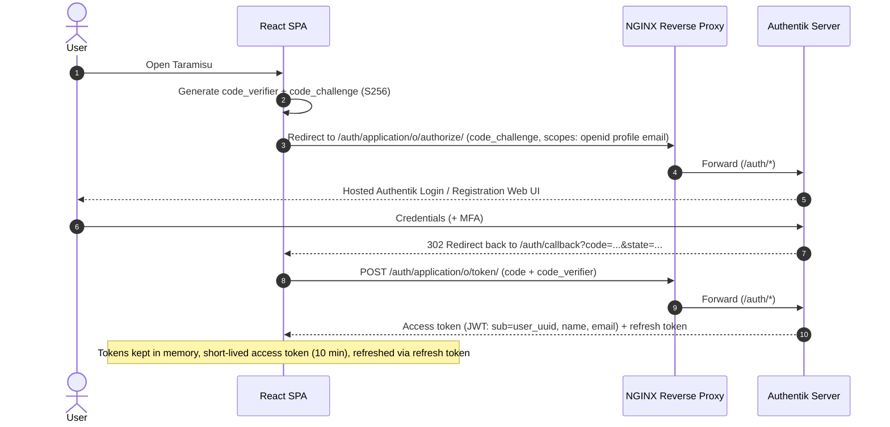
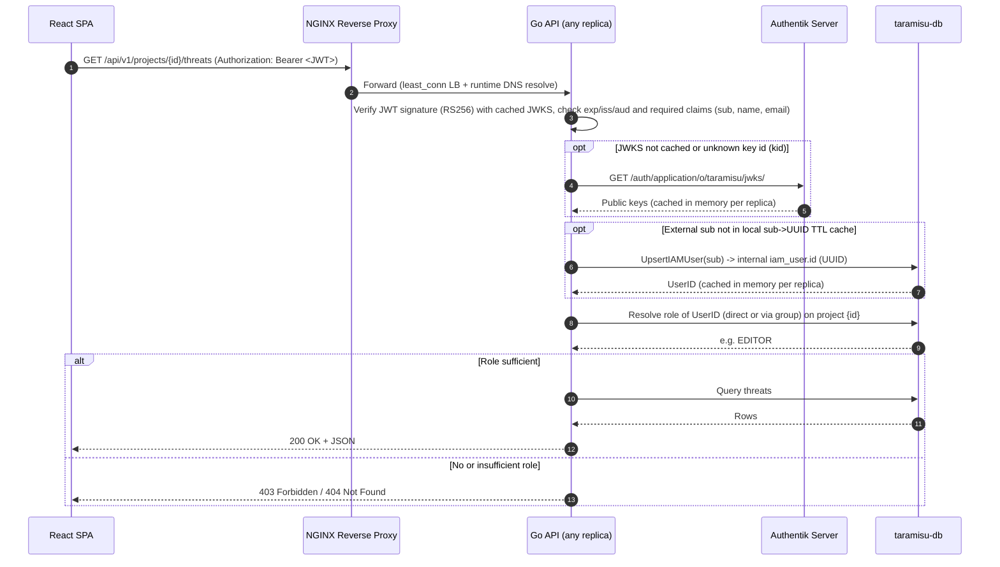
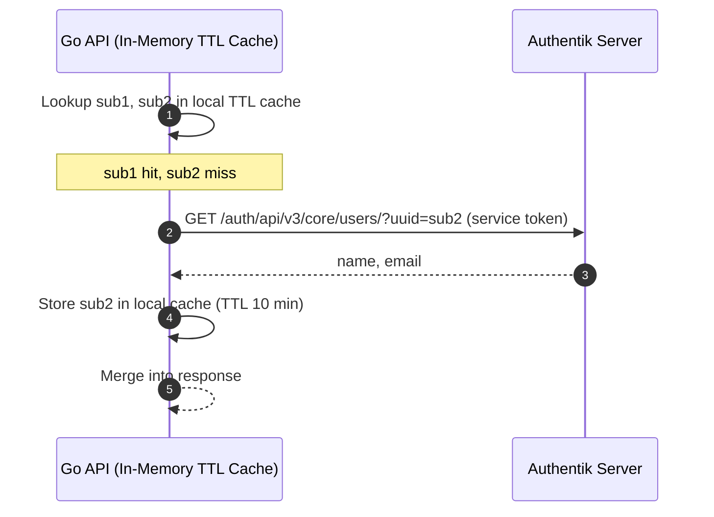

# Request Flows – Taramisu

This document visualizes the most common request flows through the architecture described in
[architecture-overview.md](./architecture-overview.md). All flows assume the React SPA acts as a public OIDC client using Authorization Code
Flow with PKCE against Authentik (routed via NGINX under `/auth/`) and holds a short-lived OIDC access token (JWT) in memory.

---

## 1. Login (OIDC Authorization Code Flow + PKCE via Authentik Web UI)

---

## 2. Authenticated API Request (Stateless JWT + Project RBAC)

Applies to every `/api/v1/*` call. The Go API cluster is 100% stateless across replicas and never trusts the client for authorization
decisions.

---

## 3. Resolving User & Group Display Metadata (In-Memory TTL Cache)

The application database only stores `external_iam_sub` and `external_iam_group_id` (Zero PII in `taramisu-db`, Decision 5).
While the caller's own `name` and `email` are extracted directly from the validated JWT claims on every request, displaying metadata for
*other* project members or groups (e.g. "created by", role assignment lists) is resolved on-the-fly via Authentik's Core API and cached in
memory per replica with a short TTL (e.g. 10 minutes, Decision 8).

> [!NOTE]
> This in-memory cache is used for **display purposes only**. Authorization never depends on cached Authentik data; `PROJECT_ROLE_ASSIGNMENT`
> is always queried live from `taramisu-db`.
