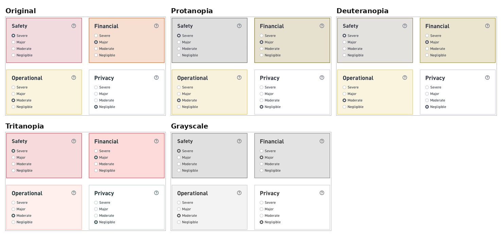
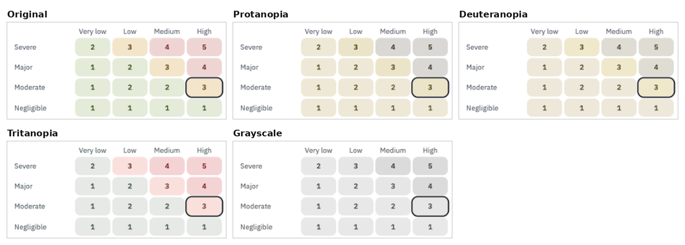
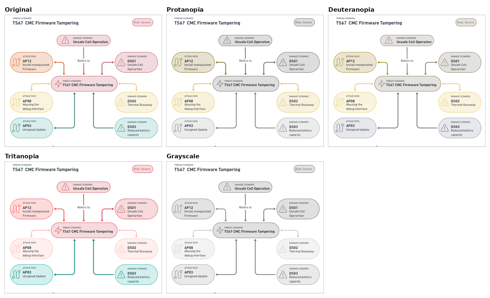

# Color-Blind Accessibility Review for the Wireframes

Issue [#88](https://github.com/thi-taramisu/taramisu/issues/88)

## Identification

The following table lists all wireframes (from [Concept #02](concept-descriptions.md)) that use color to convey information.

| Wireframe | Color Encodes | Readable without Color |
| ----------- | --------------- | ------------------------ |
| Damage Scenario: Impact Rating | Impact rating | Yes (radio buttons when selecting impacts) |
| Threat Scenario: Risks | Risks | Partially (values yes, meaning no) |
| Graph | Risks | No |

## Methodology

* Each wireframe was simulated for protanopia and deuteranopia (red-green color deficiency),
  tritanopia (blue-yellow color deficiency), and grayscale using
  [Sim Daltonism](https://apps.apple.com/de/app/sim-daltonism/id693112260).
  The results were combined into a single image using a Python script.
* A finding was recorded whenever two colors with different meanings look similar in a simulation.

## Findings

### Color Encoding for Impact Rating

| Finding                                     | Affected                            |
|---------------------------------------------|-------------------------------------|
| Severe and Major cards look very similar.   | Tritanopia, Grayscale               |
| Major and Moderate cards look very similar. | Protanopia, Deuteranopia, Grayscale |

### Color Encoding for Risks

| Finding | Affected |
| --------- | ---------- |
| Green (1, 2) and orange (3) cells look very similar. | Protanopia, Deuteranopia, Grayscale |
| Green (1, 2) and red (4, 5) cells look very similar. | Deuteranopia, Grayscale |
| Orange (3) and red (4, 5) cells look very similar. | Deuteranopia, Tritanopia, Grayscale |

## Recommendations

* Color may reinforce a rating but must never carry it alone.
  Labels should always be used to convey the information.
* The current color palette uses the same lightness for all colors.
  A new default frontend palette that gets darker as risk/impact increases already
  solves most of the issues.
* A setting in the user menu lets each user pick a palette tuned to their color vision.
  These colors should be defined once as tokens in the frontend,
  so that switching modes only swaps those values.

### Color Palettes

The following color palettes were developed as recommendations for the implementation (column "Recommendation").
Recommended palettes adapted for color vision deficiencies are also provided.
The recommended palettes were verified using the methodology described above.

#### Palette for Impact Rating

| Impact Value | Current | Recommendation | Color-blind (Protanopia, Deuteranopia) | Color-blind (Tritanopia) |
| ------------ | ----------- | ----------- | ----------- | ----------- |
| Negligible | #FFFFFF | #F1F3F5 | #EEF2F6 | #F2F2F2 |
| Moderate | #FAF3DE | #F2C14E | #9CC3E6 | #A8DADC |
| Major | #F6DFD0 | #E07A3A | #F0A04B | #E8838B |
| Severe | #F2DBDE | #A8323A | #9A4A0A | #8E1B2C |

#### Palette for Risks

| Risk Value | Current | Recommendation | Color-blind (Protanopia, Deuteranopia) | Color-blind (Tritanopia) |
| ------ | ----------- | ----------- | ----------- | ----------- |
| 1, 2 | #E4EBD8 | #CFE6BF | #9CC3E6 | #A8DADC |
| 3 | #F3E5CA | #E07A3A | #F0A04B | #E8838B |
| 4, 5 | #EED5D4 | #A8323A | #9A4A0A | #8E1B2C |
